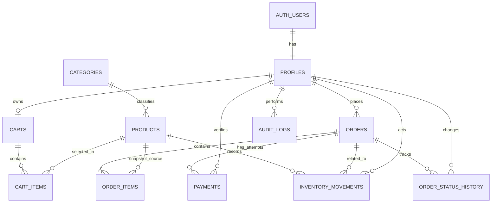
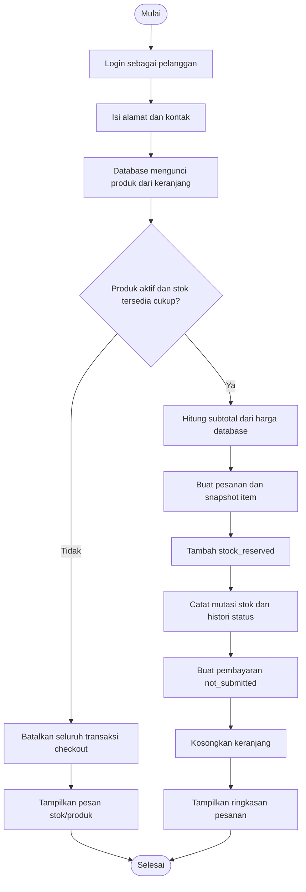
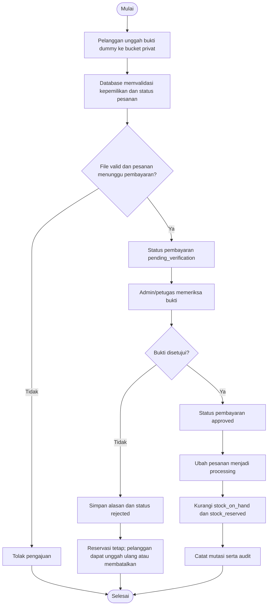
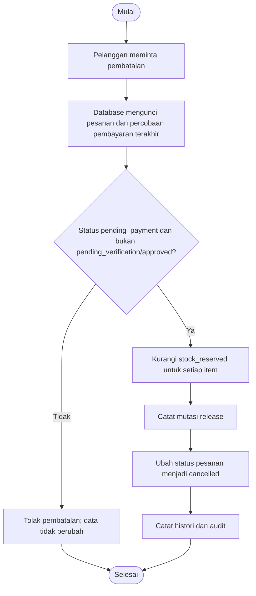

# Finalisasi PRD PetCare v1.1 — Aturan Bisnis dan Skema Supabase

**Status:** Keputusan dasar implementasi dikunci untuk proyek tugas akademik  
**Stack:** Google AI Studio untuk membantu pengembangan aplikasi; Supabase PostgreSQL, Auth, dan Storage untuk backend.  
**Berkas SQL:** `supabase_petcare_schema.sql`  

> Dokumen ini menjadi sumber keputusan final untuk aturan bisnis dan database. Jika ada pernyataan yang berbeda pada draft PRD sebelumnya, gunakan keputusan di dokumen finalisasi ini.

## 1. Keputusan proses bisnis final

### 1.1 Peran pengguna

| Peran | Kewenangan |
|---|---|
| Pengunjung (`anon`) | Melihat kategori/produk yang aktif; tidak dapat mengakses data transaksi. |
| Pelanggan (`customer`) | Mengelola keranjang sendiri, checkout, melihat pesanan sendiri, mengunggah bukti pembayaran dummy, membatalkan pesanan yang memenuhi syarat, dan mengonfirmasi penerimaan. |
| Petugas (`staff`) | Melihat pesanan dan inventaris untuk operasional; memverifikasi pembayaran simulasi; mengubah pesanan diproses menjadi dikirim; menyesuaikan stok melalui fungsi tepercaya. |
| Admin (`admin`) | Mengelola produk/kategori, mengelola akses pengguna, operasional pesanan, stok, verifikasi pembayaran, serta laporan/audit. |

Peran disimpan di `profiles.role`. Registrasi publik **selalu** menghasilkan `customer`; metadata yang dikirim dari browser tidak boleh menentukan role. Promosi peran dilakukan oleh admin melalui fungsi `admin_set_user_access`. Admin tidak dapat mengubah peran/status aktif akunnya sendiri melalui fungsi tersebut.

### 1.2 Aturan harga dan checkout

1. Katalog hanya menampilkan produk aktif. Produk harus memiliki SKU unik, harga lebih besar dari nol, serta stok fisik dan reservasi yang valid.
2. Keranjang bukan jaminan stok. Harga, status produk, dan stok diperiksa kembali oleh database ketika checkout.
3. Pelanggan mengirim alamat pengiriman dan nomor kontak yang valid. Ongkos kirim versi tugas adalah **Rp0**; total = subtotal + ongkos kirim.
4. Server menghitung harga dan total dari data produk terkini. Nilai total kiriman frontend tidak dipercaya.
5. Checkout membuat pesanan dan item snapshot (nama, SKU, harga satuan saat transaksi), membuat pembayaran awal `not_submitted`, mencatat histori, dan mereservasi stok dalam **satu transaksi database**.
6. Jika salah satu produk nonaktif atau stok tersedia tidak cukup, seluruh checkout gagal. Tidak boleh ada pesanan parsial atau reservasi sebagian.

### 1.3 Model stok yang final

Dua kolom digunakan:

- `stock_on_hand`: jumlah fisik yang ada di toko.
- `stock_reserved`: jumlah fisik yang sudah dialokasikan ke pesanan yang belum dibayar/disetujui.
- Stok yang dapat dijual = `stock_on_hand - stock_reserved`.

Contoh: stok fisik 10, reservasi 3, maka stok tersedia 7.

| Peristiwa | Perubahan `stock_on_hand` | Perubahan `stock_reserved` |
|---|---:|---:|
| Checkout 2 unit | 0 | +2 |
| Bukti pembayaran ditolak | 0 | 0 |
| Bukti pembayaran disetujui untuk 2 unit | -2 | -2 |
| Pesanan menunggu pembayaran dibatalkan secara sah | 0 | -2 |
| Barang masuk 5 unit | +5 | 0 |
| Penyesuaian keluar 1 unit | -1 | 0, jika stok fisik setelah penyesuaian tetap >= reservasi |

Setiap perubahan dicatat di `inventory_movements`. Perubahan stok hanya boleh melalui fungsi backend/database yang memvalidasi kuantitas dan mengunci baris produk. Frontend tidak boleh mengubah `stock_on_hand` atau `stock_reserved` langsung.

### 1.4 Pembayaran simulasi

- Metode pembayaran hanya `simulated_bank_transfer`; tidak ada payment gateway, koneksi bank, atau uang nyata yang diproses.
- File yang diizinkan: JPEG, PNG, atau WebP dengan batas ukuran 5 MiB, dibatasi di bucket dan divalidasi di UI/server.
- Path file: `<user_uuid>/<order_uuid>/<nama-file-acak>.<ext>` dalam bucket privat `payment-proofs`.
- File diunggah terlebih dahulu, lalu aplikasi memanggil `submit_payment_proof(order_id, proof_path)` agar database memverifikasi bahwa file benar-benar ada dan cocok dengan pemilik serta pesanan.
- Hanya ada satu percobaan aktif per pesanan. Percobaan ditolak tetap disimpan sebagai histori; pengunggahan ulang menghasilkan percobaan baru.
- Admin/petugas memeriksa bukti secara manual. Persetujuan/penolakan dilakukan melalui `verify_simulated_payment` dan hanya bisa dilakukan satu kali untuk percobaan yang masih `pending_verification`.
- Jika ditolak, alasan wajib dicatat, pesanan tetap `pending_payment`, dan reservasi stok tetap berlaku agar pelanggan dapat mencoba lagi atau membatalkan.
- Jika disetujui, status pembayaran menjadi `approved`, pesanan menjadi `processing`, dan reservasi dikonversi menjadi penjualan: stok fisik dan reservasi berkurang bersamaan.

### 1.5 Status dan pembatalan pesanan

Status pesanan yang valid:

`pending_payment → processing → shipped → completed`

Jalur pembatalan: `pending_payment → cancelled`, hanya jika percobaan pembayaran terakhir berstatus `not_submitted` atau `rejected`.

| Aksi | Aturan |
|---|---|
| Checkout | Membuat `pending_payment` |
| Admin/petugas menyetujui pembayaran | `pending_payment → processing` |
| Admin/petugas mengirim | `processing → shipped`; nomor resi wajib diisi |
| Pelanggan mengonfirmasi penerimaan | `shipped → completed` |
| Pelanggan membatalkan | Hanya `pending_payment` dan pembayaran terakhir bukan `pending_verification`/`approved` |
| Pembayaran sedang diverifikasi | Pembatalan dilarang sampai keputusan verifikasi dibuat |
| Pembayaran sudah disetujui | Pembatalan mandiri tidak tersedia pada MVP |
| Permintaan status tidak sah/diulang | Ditolak; tidak boleh menggandakan mutasi stok atau riwayat sukses |

### 1.6 CRUD dan penghapusan

| Entitas | Create | Read | Update | Delete/arsip |
|---|---|---|---|---|
| Produk | Admin | Produk aktif publik; staf/admin dapat melihat semua | Admin untuk detail dan status; stok melalui RPC | Hapus permanen hanya jika tidak direferensikan; selain itu nonaktifkan |
| Kategori | Admin | Kategori aktif publik; staf/admin semua | Admin | Foreign key mencegah hapus kategori yang masih digunakan |
| Item keranjang | Pemilik | Pemilik | Pemilik | Pemilik |
| Pesanan | Fungsi checkout | Pemilik atau staf/admin | Hanya fungsi transisi status | Tidak hard delete; pembatalan adalah status |
| Pembayaran | Dibuat alur checkout | Pemilik atau staf/admin | Fungsi unggah/verifikasi; percobaan lama dipertahankan | Tidak hard delete dari histori |
| Inventaris/mutasi | Fungsi checkout/stok | Staf/admin | Tidak edit mutasi historis; lakukan mutasi koreksi baru | Tidak hard delete |
| Profil/peran | Auth + trigger profil; admin mengatur peran | Pemilik profil/admin | Pemilik hanya nama/telepon; admin melalui RPC untuk role/status | Nonaktifkan akun; histori tetap disimpan |
| Histori status dan audit | Fungsi terpercaya | Pemilik pesanan untuk histori status; admin untuk audit | Tidak diedit dari client | Tidak hard delete |

CRUD tetap wajib untuk katalog, kategori, profil yang diizinkan, dan keranjang. Pada data transaksi/audit, operasi “delete” direpresentasikan dengan pembatalan atau pengarsipan demi menjaga integritas histori.

### 1.7 Batas MVP lain

- Tidak ada otomatisasi kedaluwarsa reservasi pada baseline; reservasi dilepas melalui pembatalan yang sah. Fitur expiry/cron dapat ditambahkan kemudian.
- Tidak ada katalog multi-cabang, sistem akuntansi penuh, refund uang nyata, atau integrasi kurir; nomor resi diinput manual.
- Riwayat transaksi menyimpan snapshot nama/SKU/harga agar perubahan produk tidak mengubah faktur historis.

## 2. Skema database final

### 2.1 Entitas dan relasi

| Tabel | Tujuan | Relasi utama |
|---|---|---|
| `profiles` | Profil dan peran pengguna | `id → auth.users.id` |
| `categories` | Klasifikasi produk | Satu kategori memiliki banyak produk |
| `products` | Katalog, stok fisik, stok reservasi | `category_id → categories.id` |
| `carts` | Satu keranjang aktif per pelanggan | `user_id → profiles.id` unik |
| `cart_items` | Item keranjang | `cart_id → carts.id`, `product_id → products.id`; unik per keranjang/produk |
| `orders` | Header pesanan dan total | `user_id → profiles.id` |
| `order_items` | Rincian pesanan dan snapshot harga | `order_id → orders.id`, `product_id → products.id` |
| `payments` | Setiap percobaan pembayaran simulasi | `order_id → orders.id`; nomor percobaan unik per pesanan |
| `inventory_movements` | Jejak stok masuk, reservasi, penjualan, pelepasan | `product_id`, `actor_id`, `order_id` |
| `order_status_history` | Riwayat transisi status | `order_id`, `actor_id` |
| `audit_logs` | Audit aksi administratif/operasional | `actor_id`, jenis dan ID entitas, metadata |

### 2.2 ERD (Mermaid)

Diagram berikut menunjukkan relasi utama. `AUTH_USERS` mewakili tabel sistem `auth.users` yang dikelola Supabase, bukan tabel aplikasi yang perlu dibuat manual.

### 2.3 Constraint yang harus dipertahankan

- `products.sku` unik, `price > 0`, `stock_on_hand >= 0`, `0 <= stock_reserved <= stock_on_hand`.
- `cart_items.quantity` dan `order_items.quantity` harus bilangan bulat positif.
- `orders.total = subtotal + shipping_cost`; semua nilai uang memakai `numeric`, bukan floating point.
- `payments` mempunyai `unique(order_id, attempt_no)` dan partial unique index untuk memastikan maksimal satu percobaan `not_submitted`/`pending_verification` per pesanan.
- Foreign key penting memakai `RESTRICT` agar produk/kategori yang masih memiliki histori tidak hilang. Produk tanpa referensi tetap dapat dihapus oleh admin.
- RLS aktif untuk semua tabel aplikasi. Grant SQL juga dibatasi: client tidak mendapat hak tulis langsung ke transaksi, pembayaran, mutasi stok, histori, atau audit.

### 2.4 Kebijakan RLS

- Pengunjung hanya dapat membaca produk/kategori aktif.
- Pelanggan hanya dapat membaca/mengelola keranjangnya sendiri dan membaca pesanan, rincian, histori, serta pembayaran miliknya.
- Staf/admin dapat membaca data operasional yang diperlukan sesuai role.
- Perubahan status pesanan, verifikasi pembayaran, checkout, penyesuaian stok, serta pengubahan role menggunakan fungsi database tepercaya; bukan update langsung dari browser.
- `profiles.role` tidak pernah diambil dari metadata registrasi. Perubahan role/status aktif dibatasi pada jalur admin.
- Bucket `payment-proofs` bersifat privat. Bucket `product-images` bersifat publik untuk menampilkan gambar katalog, tetapi hanya admin dapat mengunggah/mengubah/menghapus gambar.

Supabase merekomendasikan RLS sebagai pertahanan data per baris, Storage private untuk dokumen sensitif, dan pengamanan `SECURITY DEFINER` dengan `search_path` tetap serta izin execute yang dibatasi. Lihat [RLS](https://supabase.com/docs/guides/database/postgres/row-level-security), [Database Functions](https://supabase.com/docs/guides/database/functions), dan [Storage Access Control](https://supabase.com/docs/guides/storage/security/access-control).

## 3. UML Activity Diagram — alur inti

### 3.1 Checkout dan reservasi stok

### 3.2 Verifikasi pembayaran simulasi

### 3.3 Pembatalan dan pelepasan reservasi

## 4. Cara memasang skema

1. Buat proyek Supabase khusus development/tugas.
2. Buka **SQL Editor**, lalu jalankan file `supabase_petcare_schema.sql` pada proyek baru. File ini baseline satu kali untuk proyek baru, bukan migration idempoten untuk database yang sudah memiliki tabel.
3. Buat akun pertama melalui Supabase Auth, lalu jalankan perintah promosi admin yang dicantumkan di bagian akhir file SQL dengan UUID akun tersebut. Jangan membuat admin melalui metadata registrasi.
4. Buat produk. Produk baru bermula dengan stok nol; tambah stok melalui fungsi `adjust_stock(product_id, quantity_delta, reason)`.
5. Pastikan bucket `product-images` dan `payment-proofs` dibuat; file SQL mengonfigurasi keduanya. Pastikan bukti transfer tidak dipasang pada bucket publik.
6. Hubungkan frontend dengan Supabase URL dan publishable/anon key. **Jangan pernah memasukkan `service_role`/secret key ke frontend atau prompt yang menghasilkan kode client.**
7. Terapkan alur frontend: upload bukti → panggil RPC submit; panggil RPC lain untuk checkout, verifikasi, pengiriman, konfirmasi penerimaan, dan penyesuaian stok.
8. Uji RLS dengan akun `anon`, `customer`, `staff`, dan `admin` yang berbeda; jangan hanya menguji sebagai admin.

## 5. RPC yang dipakai frontend

| Fungsi | Dipanggil oleh | Efek |
|---|---|---|
| `checkout_cart(address, phone)` | Pelanggan | Membuat order/items/payment awal, reservasi stok, mengosongkan cart |
| `submit_payment_proof(order_id, proof_path)` | Pemilik pesanan | Mengikat file yang sudah diunggah dan membuat/memperbarui percobaan pembayaran |
| `verify_simulated_payment(payment_id, approve, reason)` | Staf/admin | Menyetujui atau menolak; approval mengonversi reservasi menjadi penjualan |
| `cancel_pending_order(order_id)` | Pemilik pesanan | Membatalkan pesanan yang masih memenuhi syarat dan melepas reservasi |
| `ship_order(order_id, tracking_number)` | Staf/admin | `processing → shipped` dan menyimpan resi |
| `confirm_order_received(order_id)` | Pemilik pesanan | `shipped → completed` |
| `adjust_stock(product_id, quantity_delta, reason)` | Staf/admin | Mutasi stok tervalidasi dan audit |
| `admin_set_user_access(user_id, role, is_active)` | Admin | Mengubah peran/status aktif akun selain dirinya sendiri |

Pemanggilan RPC tidak menggantikan pengecekan RLS untuk query biasa. Fungsi `SECURITY DEFINER` pada file SQL membatasi `EXECUTE` untuk `authenticated`, memverifikasi `auth.uid()`/role di dalam fungsi, dan menetapkan `search_path` kosong.

## 6. Penyesuaian pengujian untuk baseline final

60 skenario pada PRD utama tetap digunakan dengan interpretasi berikut:

- **TC-25/27:** total dan stok divalidasi server-side; reservasi dilakukan atomik.
- **TC-30/31:** pembatalan hanya sebelum pembayaran disetujui dan tidak saat bukti menunggu verifikasi.
- **TC-37–45:** bucket bukti privat; status dan percobaan pembayaran tetap tercatat; approval mengurangi stok fisik dan reservasi bersamaan.
- **TC-46–50:** stok fisik dipisahkan dari reservasi; koreksi tidak boleh menurunkan stok fisik di bawah jumlah reservasi.
- **TC-52–55:** perubahan role hanya melalui RPC admin; pelanggan tidak dapat menembus RLS dengan mengganti ID pesanan.
- **TC-57:** kegagalan RPC harus ditampilkan sebagai kegagalan; frontend tidak boleh menganggap transaksi sukses bila fungsi database error.

## 7. Batasan dan pemeriksaan sebelum demo

- File SQL belum dijalankan terhadap proyek Supabase milik pengguna; jalankan pada proyek development dan periksa pesan error sebelum demonstrasi.
- Kebijakan RLS perlu diuji memakai sesi dari setiap role; SQL bukan pengganti pengujian integrasi.
- Validasi MIME dan ukuran Storage berguna, tetapi bukan pemeriksaan keamanan konten file tingkat produksi. Untuk proyek tugas gunakan file gambar dummy.
- Setelah skema berhasil dipasang, lakukan satu alur end-to-end: registrasi customer → admin membuat kategori/produk → stok masuk → customer checkout → unggah bukti dummy → admin menyetujui → admin mengirim + resi → customer mengonfirmasi diterima.
