# PRD --- PetCare: Sistem Informasi Petshop Berbasis Web

**Versi:** 1.1\
**Status:** Finalisasi aturan bisnis dan skema database; gunakan addendum final v1.1 sebagai sumber keputusan\
**Platform pengembangan:** Google AI Studio\
**Backend dan database:** Supabase (PostgreSQL, Auth, Storage)\
**Jenis dokumen:** Product Requirements Document + 60 skenario pengujian
dengan UML Activity Diagram Mermaid

## 1. Ringkasan produk

PetCare adalah website untuk mengelola proses bisnis petshop: katalog
dan kategori produk, inventaris, keranjang, checkout, pesanan,
pembayaran simulasi, pengguna, serta laporan. Pelanggan dapat menjelajah
produk, memesan, mengunggah bukti transfer dummy, dan memantau status.
Admin/petugas mengelola operasional sesuai hak akses.

Pembayaran hanya simulasi untuk tugas akademik. Tidak ada transaksi uang
sungguhan, integrasi bank, payment gateway, atau klaim pembayaran
otomatis. Bukti transfer adalah file dummy yang diverifikasi manual oleh
admin.

## 2. Tujuan dan metrik keberhasilan

-   Semua modul CRUD yang ditetapkan memiliki Create, Read, Update,
    Delete atau mekanisme arsip yang dijelaskan.
-   Data utama tersimpan di Supabase, bukan hanya state browser/local
    storage.
-   Stok tidak negatif dan operasi checkout/pembatalan aman terhadap
    permintaan ganda.
-   Setiap pesanan memiliki rincian harga pada saat transaksi agar
    perubahan harga produk tidak mengubah riwayat.
-   Hak akses diterapkan di UI dan backend menggunakan Supabase RLS
    serta pemeriksaan peran.
-   Seluruh 60 skenario di bawah dapat dijalankan ulang dengan data uji
    yang disiapkan.

## 3. Sasaran pengguna dan peran

  -----------------------------------------------------------------------
  Peran                   Tujuan                  Hak utama
  ----------------------- ----------------------- -----------------------
  Pengunjung              Menjelajah katalog      Membaca produk/kategori
                                                  aktif; registrasi/login

  Pelanggan               Membeli dan memantau    Keranjang, checkout,
                          pesanan                 riwayat pesanan
                                                  sendiri, unggah bukti
                                                  dummy, pembatalan
                                                  sesuai status

  Petugas                 Membantu operasional    Melihat/memperbarui
                                                  pesanan dan stok sesuai
                                                  izin yang diberikan

  Admin                   Mengelola sistem        CRUD produk/kategori,
                                                  inventaris, pengguna,
                                                  pesanan, verifikasi
                                                  pembayaran, laporan
  -----------------------------------------------------------------------

Prinsip hak akses minimum: petugas tidak otomatis memiliki izin mengubah
peran admin atau menghapus akun admin. Operasi administratif sensitif
dibatasi ke admin.

## 4. Ruang lingkup

### Termasuk (in scope)

1.  Autentikasi dan profil pengguna.
2.  CRUD produk dan kategori, gambar produk, status aktif/nonaktif.
3.  Katalog publik dengan pencarian, filter, detail produk.
4.  Keranjang dan checkout.
5.  Manajemen pesanan dan riwayat perubahan status.
6.  Pembayaran simulasi dengan unggah bukti transfer dummy serta
    verifikasi/penolakan manual.
7.  Pengelolaan stok, penyesuaian stok, dan log mutasi.
8.  Manajemen akun/peran yang dibatasi.
9.  Dashboard dan laporan sederhana berdasarkan data transaksi.
10. Validasi, keamanan, pesan kesalahan, dan audit untuk operasi
    penting.

### Tidak termasuk (out of scope)

-   Pembayaran uang sungguhan, payment gateway, integrasi bank, refund
    uang nyata.
-   Pengiriman/logistik pihak ketiga secara langsung; nomor resi hanya
    dicatat manual.
-   Aplikasi native Android/iOS.
-   Multi-cabang dan akuntansi penuh.
-   Rekomendasi AI untuk diagnosis atau perawatan medis hewan.
-   Sinkronisasi inventaris dengan marketplace eksternal.

## 5. Proses bisnis utama

### BP-01 --- Pengelolaan katalog

Admin membuat kategori dan produk dengan SKU unik, harga
nonnegatif/positif sesuai kebijakan, stok bilangan bulat nonnegatif,
deskripsi, gambar, dan status aktif. Produk aktif muncul di katalog.
Produk yang pernah digunakan dalam transaksi sebaiknya
dinonaktifkan/diarsipkan, bukan dihapus permanen, agar histori transaksi
tetap utuh.

### BP-02 --- Pemesanan

Pelanggan memilih produk, menentukan jumlah, dan memasukkannya ke
keranjang. Saat checkout, server memvalidasi ulang harga, status produk,
jumlah, dan stok terkini. Pembuatan pesanan, detail pesanan, dan
reservasi/pengurangan stok harus dilakukan atomik dalam transaksi
database atau fungsi server yang tepercaya. Total dihitung server, bukan
dipercaya dari browser.

### BP-03 --- Pembayaran simulasi

Pesanan yang berhasil dibuat berstatus `pending_payment`. Pelanggan
mengunggah bukti transfer dummy ke bucket privat. Pembayaran berstatus
`pending_verification` sampai admin menyetujui atau menolak dengan
alasan. Persetujuan mengubah pembayaran menjadi `approved` dan pesanan
menjadi `processing` sesuai aturan status. Penolakan mengubah pembayaran
menjadi `rejected` sehingga pelanggan dapat mengunggah ulang. UI harus
menampilkan label jelas **"Simulasi --- tidak ada uang sungguhan yang
diproses."**

### BP-04 --- Pemenuhan pesanan

Petugas/admin memproses pesanan yang pembayarannya disetujui, memasukkan
nomor resi saat status `shipped`, lalu pelanggan dapat mengonfirmasi
penerimaan sehingga status menjadi `completed`. Perubahan status hanya
boleh mengikuti transisi yang diizinkan.

### BP-05 --- Pembatalan dan stok

Pembatalan hanya diizinkan pada status yang memenuhi aturan bisnis.
Pelepasan reservasi stok harus dilakukan tepat satu kali. Operasi
berulang (double-click/retry) tidak boleh menggandakan stok atau membuat
pesanan ganda.

### BP-06 --- Inventaris dan laporan

Admin/petugas berizin mencatat barang masuk dan penyesuaian dengan
alasan. Semua mutasi stok mencatat produk, perubahan kuantitas, waktu,
aktor, sumber, dan referensi transaksi jika ada. Laporan menghitung
transaksi berdasarkan aturan status dan rentang tanggal yang eksplisit.

## 6. Alur status

### Status pesanan yang disarankan

`pending_payment → processing → shipped → completed`

Transisi alternatif: - `pending_payment → cancelled` -
`processing → cancelled` hanya jika belum dikirim dan sesuai kebijakan;
pelepasan stok dilakukan satu kali. - `shipped` tidak dapat langsung
dibatalkan dari UI biasa. - Transisi tidak sah ditolak di backend, bukan
hanya disembunyikan di frontend.

### Status pembayaran simulasi

`not_submitted → pending_verification → approved` atau
`pending_verification → rejected → pending_verification` setelah unggah
bukti baru.

Status pembayaran dan pesanan disimpan terpisah agar jejak verifikasi
jelas.

## 7. Persyaratan fungsional

  -----------------------------------------------------------------------
  ID                                  Persyaratan
  ----------------------------------- -----------------------------------
  FR-01                               Pengguna dapat registrasi, login,
                                      dan logout.

  FR-02                               Katalog menampilkan produk aktif
                                      dengan pencarian, filter kategori,
                                      dan detail.

  FR-03                               Admin dapat membuat, membaca,
                                      memperbarui, dan
                                      mengarsipkan/menghapus produk
                                      sesuai relasi data.

  FR-04                               Admin dapat CRUD kategori dengan
                                      perlindungan terhadap kategori yang
                                      masih digunakan.

  FR-05                               Pelanggan dapat menambah, mengubah
                                      kuantitas, dan menghapus item
                                      keranjang.

  FR-06                               Checkout memvalidasi stok dan harga
                                      terkini di sisi server serta
                                      membuat pesanan secara atomik.

  FR-07                               Pelanggan hanya dapat melihat
                                      pesanan dan pembayaran miliknya.

  FR-08                               Admin/petugas berizin dapat melihat
                                      dan memperbarui pesanan melalui
                                      transisi status yang sah.

  FR-09                               Pelanggan dapat mengunggah bukti
                                      transfer dummy dengan validasi MIME
                                      dan ukuran.

  FR-10                               Admin dapat menyetujui/menolak
                                      bukti dengan alasan dan audit
                                      trail.

  FR-11                               Sistem mencatat mutasi stok untuk
                                      penerimaan, penyesuaian, checkout,
                                      dan pembatalan.

  FR-12                               Admin dapat mengelola akun dan
                                      peran dengan batasan hak akses.

  FR-13                               Dashboard dan laporan menampilkan
                                      data sesuai filter dan kewenangan.

  FR-14                               Semua operasi gagal memberikan
                                      pesan aman dan tidak menampilkan
                                      secret atau stack trace.

  FR-15                               Operasi sensitif idempoten atau
                                      terlindungi dari pengiriman ganda.
  -----------------------------------------------------------------------

## 8. Persyaratan nonfungsional

-   **Keamanan:** RLS aktif pada tabel yang terekspos; validasi
    otorisasi di database/server; jangan menaruh `service_role` key di
    client.
-   **Integritas:** stok tidak negatif; total dihitung server; foreign
    key dan constraint digunakan; operasi multi-tabel penting atomik.
-   **Privasi:** bukti pembayaran disimpan di bucket privat dan hanya
    dapat diakses pemilik serta petugas/admin berizin melalui URL
    bertanda tangan yang berumur pendek.
-   **Kinerja:** target awal halaman katalog dan daftar umum responsif
    pada dataset tugas; pagination/filter digunakan agar query tidak
    mengambil semua baris.
-   **Aksesibilitas:** form memiliki label, pesan validasi jelas,
    navigasi keyboard dasar, dan kontras memadai.
-   **Keterpeliharaan:** komponen UI, validasi, layanan data, dan aturan
    status dipisahkan; semua konfigurasi lingkungan didokumentasikan.
-   **Auditabilitas:** verifikasi pembayaran, perubahan status,
    perubahan peran, dan mutasi stok mencatat aktor serta waktu.
-   **Keandalan:** loading, empty state, timeout, retry, dan error state
    ditangani secara konsisten.

## 9. Model data Supabase yang disarankan

Tabel inti: 1. `profiles` --- `id` (UUID sama dengan `auth.users.id`),
`full_name`, `phone`, `role` (`customer`, `staff`, `admin`),
`is_active`, timestamps. 2. `categories` --- `id`, `name`, `slug`,
`description`, `is_active`, timestamps. 3. `products` --- `id`,
`category_id`, `sku` unik, `name`, `description`, `price` numeric,
`stock_qty` integer, `image_path`, `is_active`, timestamps. 4. `carts`
--- `id`, `user_id`, timestamps. 5. `cart_items` --- `id`, `cart_id`,
`product_id`, `quantity`; unique gabungan cart/product. 6. `orders` ---
`id`, `order_number` unik, `user_id`, `status`, `subtotal`,
`shipping_cost` (boleh nol untuk tugas), `total`, snapshot
alamat/kontak, timestamps. 7. `order_items` --- `id`, `order_id`,
`product_id` nullable bila produk diarsipkan, `product_name_snapshot`,
`sku_snapshot`, `unit_price_snapshot`, `quantity`, `line_total`. 8.
`payments` --- `id`, `order_id`, `method` (mis.
`simulated_bank_transfer`), `status`, `proof_path`, `submitted_at`,
`verified_by`, `verified_at`, `rejection_reason`. 9.
`inventory_movements` --- `id`, `product_id`, `actor_id`,
`movement_type`, `quantity_delta`, `reason`, `reference_type`,
`reference_id`, timestamp. 10. `order_status_history` --- `id`,
`order_id`, `old_status`, `new_status`, `actor_id`, `note`, timestamp.
11. `audit_logs` --- `id`, `actor_id`, `action`, `entity_type`,
`entity_id`, metadata aman, timestamp.

### Aturan database penting

-   Gunakan foreign key, unique constraint untuk `products.sku` dan
    `orders.order_number`, serta check constraint untuk `price > 0`,
    `stock_qty >= 0`, dan `quantity > 0`.
-   Nilai uang disimpan sebagai `numeric`/decimal, bukan floating point.
-   Gunakan fungsi database/RPC atau backend tepercaya untuk checkout,
    verifikasi pembayaran, transisi status, dan perubahan stok.
-   Harga dan total dari client hanya menjadi input tampilan; server
    menghitung ulang.
-   Hindari hard delete untuk produk/kategori/pengguna yang
    direferensikan histori; gunakan soft delete atau nonaktifkan.
-   Jangan izinkan client mengubah `role`, `verified_by`,
    `payment.status`, atau stok langsung tanpa jalur otorisasi yang
    tepat.

## 10. Matriks CRUD

  ----------------------------------------------------------------------------------
  Entitas          Create         Read           Update            Delete/arsip
  ---------------- -------------- -------------- ----------------- -----------------
  Produk           Admin          Publik untuk   Admin             Arsip/nonaktif;
                                  produk aktif;                    hard delete hanya
                                  admin untuk                      jika belum
                                  semua                            direferensikan

  Kategori         Admin          Publik/admin   Admin             Tolak jika masih
                                  sesuai status                    digunakan atau
                                                                   arsipkan

  Keranjang/item   Pelanggan      Pemilik        Pemilik keranjang Pemilik keranjang
                                  keranjang                        

  Pesanan          Pelanggan      Pemilik dan    Transisi status   Pembatalan sesuai
                   melalui        staf berizin   melalui aturan    status; bukan
                   checkout                                        hard delete

  Pembayaran       Dibuat sistem  Pemilik dan    Unggah            Tidak dihapus
                   saat pesanan   admin/staf     ulang/keputusan   dari histori;
                                  berizin        verifikasi        arsip/retensi
                                                 melalui jalur     bila perlu
                                                 khusus            

  Mutasi stok      Admin/staf     Admin/staf     Tidak diedit      Tidak dihapus
                   atau proses    berizin        langsung; koreksi dari audit
                   pesanan                       dengan mutasi     
                                                 baru              

  Pengguna/peran   Admin/alur     Pemilik        Pemilik field     Nonaktifkan,
                   registrasi     profil/admin   profil terbatas;  jangan hard
                   terbatas       sesuai         admin field       delete histori
                                  kebijakan      administratif     

  Laporan          Dibentuk dari  Admin          Filter query      Tidak berlaku
                   query                                           
  ----------------------------------------------------------------------------------

## 11. Rekomendasi struktur aplikasi

-   **Frontend:** React/TypeScript atau stack yang dihasilkan Google AI
    Studio; pisahkan halaman, komponen, validasi, dan service layer.
-   **Supabase Auth:** sesi pengguna dan identitas.
-   **Supabase Database:** PostgreSQL, constraint, RLS, dan fungsi
    transaksi.
-   **Supabase Storage:** bucket privat `payment-proofs`; bucket gambar
    produk dapat publik hanya jika memang tidak sensitif.
-   **Server-side trusted operations:** checkout, validasi stok,
    perubahan status, verifikasi pembayaran, dan penyesuaian stok.
    Gunakan RPC dengan hak minimum atau Edge Function/backend tepercaya.
-   **Environment:** URL Supabase dan anon/publishable key dapat dipakai
    di client sesuai konfigurasi; `service_role` hanya pada lingkungan
    server rahasia.

## 12. Aturan keamanan RLS minimum

-   `profiles`: pengguna membaca/mengubah field profil miliknya;
    perubahan `role` dan `is_active` hanya admin melalui jalur aman.
-   `products`/`categories`: publik hanya membaca yang aktif; admin
    mengelola data; petugas sesuai kebutuhan operasional.
-   `carts`/`cart_items`: hanya pemilik keranjang.
-   `orders`/`order_items`/`payments`: pelanggan hanya membaca miliknya;
    pembuatan/perubahan status sensitif melalui fungsi tepercaya;
    admin/staf sesuai peran.
-   `payment-proofs`: bucket privat; path tidak dianggap sebagai
    otorisasi. Akses harus diverifikasi berdasarkan order/payment dan
    peran.
-   `inventory_movements`/`audit_logs`: baca hanya untuk peran
    berwenang; penulisan lewat fungsi operasional, bukan manipulasi
    bebas dari client.

## 13. Asumsi dan keputusan awal

-   Website adalah proyek tugas/portofolio, bukan sistem produksi untuk
    transaksi nyata.
-   Pembayaran hanya simulasi transfer; bukti yang diunggah merupakan
    dummy.
-   Biaya pengiriman dapat ditetapkan nol atau sebagai nilai tetap
    konfigurasi untuk menyederhanakan tugas.
-   Pengguna memiliki peran `customer`, `staff`, atau `admin`.
-   Semua waktu disimpan dalam UTC di database dan ditampilkan sesuai
    zona waktu aplikasi.
-   Retensi file dummy dan audit mengikuti kebutuhan tugas; data
    transaksi historis tidak dihapus sembarangan.
-   Penghapusan data yang terkait pesanan menggunakan arsip/soft delete
    agar histori tetap valid.

## 14. Kriteria penerimaan tingkat produk

1.  Semua modul pada matriks CRUD dapat diuji sesuai batas akses.
2.  Pelanggan tidak dapat membaca pesanan, profil administratif, atau
    bukti milik pengguna lain.
3.  Admin dapat mengelola produk/kategori dan memverifikasi pembayaran
    simulasi.
4.  Checkout memvalidasi stok dan menghitung total di server; tidak ada
    stok negatif.
5.  Status pesanan hanya mengikuti transisi yang diperbolehkan.
6.  Bukti pembayaran yang salah tipe/ukuran ditolak dan bucket bersifat
    privat.
7.  Penolakan pembayaran menyimpan alasan; unggah ulang tidak menghapus
    histori verifikasi.
8.  Dashboard/laporan konsisten dengan sumber data dan filter.
9.  Seluruh 60 skenario di bawah lulus atau kegagalan yang ditemukan
    didokumentasikan sebagai defect.

## 15. Format skenario pengujian

Setiap skenario memuat ID, prasyarat, langkah, data uji, hasil yang
diharapkan, dan UML Activity Diagram dalam Mermaid. Diagram
merepresentasikan alur aktivitas, termasuk percabangan penting untuk
skenario gagal. Data email, SKU, nomor pesanan, dan bukti pada dokumen
ini adalah data dummy.

## 16. Skenario pengujian dan UML Activity Diagram

### TC-01 --- Registrasi pelanggan berhasil

**Aktor:** Pelanggan\
**Prasyarat:** Pengunjung belum memiliki akun dan email belum
terdaftar.\
**Langkah pengujian:** 1. Buka halaman registrasi. 2. Isi nama, email,
dan kata sandi valid. 3. Kirim formulir.

**Data uji:** Nama: Budi; email: budi@example.test; kata sandi sesuai
kebijakan.\
**Hasil yang diharapkan:** Akun dibuat; profil pelanggan tersimpan;
pengguna mendapat konfirmasi.

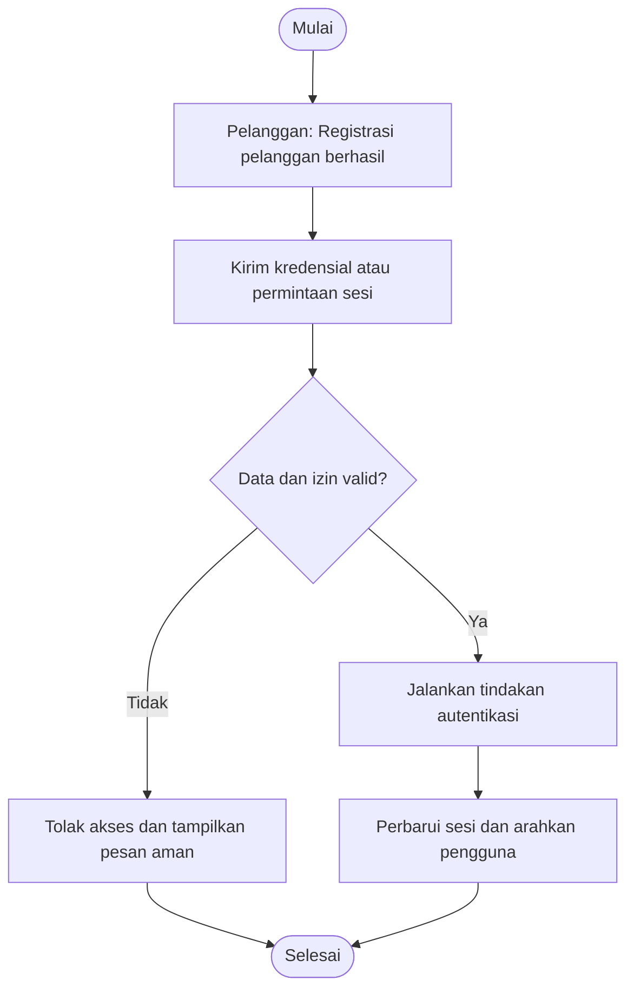

### TC-02 --- Registrasi dengan email yang sudah digunakan

**Aktor:** Pelanggan\
**Prasyarat:** Email sudah terdaftar.\
**Langkah pengujian:** 1. Buka registrasi. 2. Masukkan email yang telah
digunakan. 3. Kirim formulir.

**Data uji:** Email: budi@example.test.\
**Hasil yang diharapkan:** Registrasi ditolak; tidak ada akun duplikat;
pesan kesalahan ditampilkan.


### TC-03 --- Login pelanggan berhasil

**Aktor:** Pelanggan\
**Prasyarat:** Akun pelanggan aktif tersedia.\
**Langkah pengujian:** 1. Buka halaman login. 2. Masukkan kredensial
benar. 3. Tekan Login.

**Data uji:** Email dan kata sandi valid.\
**Hasil yang diharapkan:** Sesi dibuat; pelanggan diarahkan ke halaman
yang sesuai perannya.

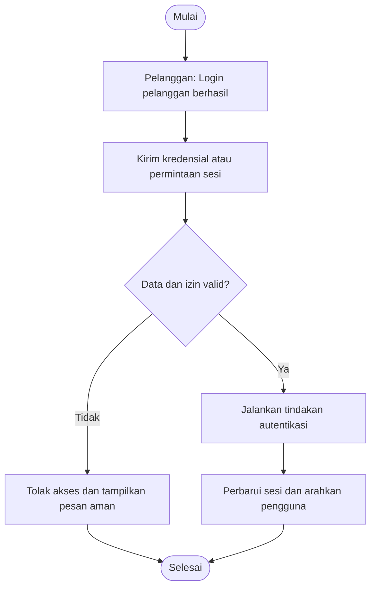

### TC-04 --- Login dengan kata sandi salah

**Aktor:** Pelanggan\
**Prasyarat:** Akun tersedia.\
**Langkah pengujian:** 1. Masukkan email valid dan kata sandi salah. 2.
Tekan Login.

**Data uji:** Email terdaftar; kata sandi salah.\
**Hasil yang diharapkan:** Login ditolak; pesan tidak membocorkan apakah
email atau kata sandi yang salah.


### TC-05 --- Logout pengguna

**Aktor:** Pelanggan\
**Prasyarat:** Pengguna sedang login.\
**Langkah pengujian:** 1. Buka menu akun. 2. Pilih Logout.

**Data uji:** Sesi aktif.\
**Hasil yang diharapkan:** Sesi diakhiri dan halaman terlindungi tidak
dapat dibuka tanpa login kembali.

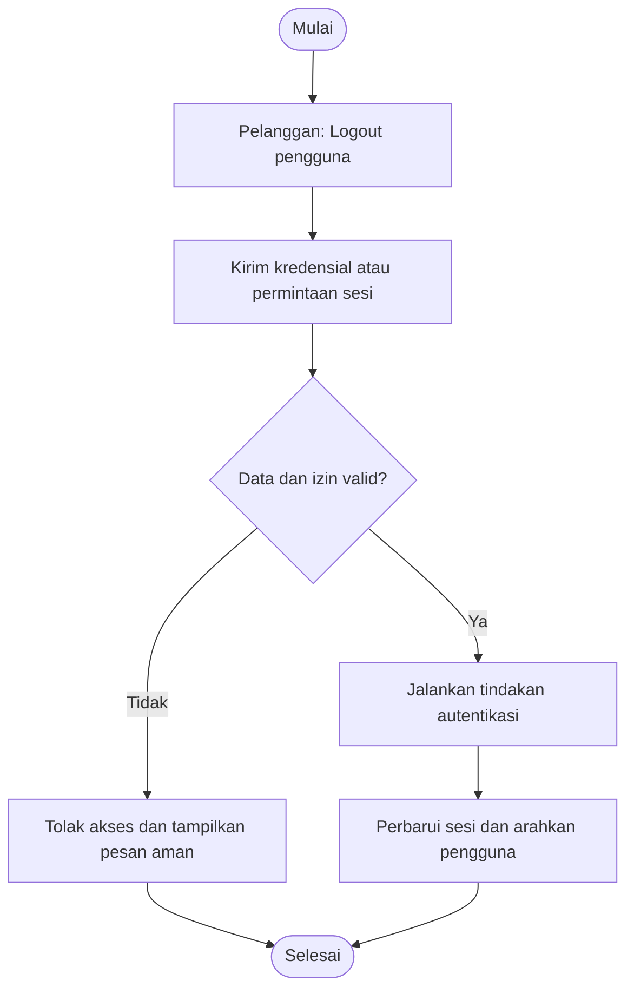

### TC-06 --- Pelanggan melihat katalog produk

**Aktor:** Admin\
**Prasyarat:** Produk aktif tersedia.\
**Langkah pengujian:** 1. Buka katalog. 2. Tunggu data dimuat.

**Data uji:** Produk aktif dengan harga dan stok.\
**Hasil yang diharapkan:** Katalog menampilkan produk aktif beserta
harga, foto, dan ketersediaan.

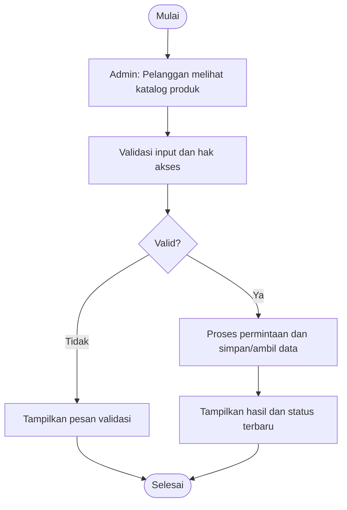

### TC-07 --- Pencarian produk berdasarkan kata kunci

**Aktor:** Admin\
**Prasyarat:** Katalog memiliki produk dengan nama yang cocok.\
**Langkah pengujian:** 1. Masukkan kata kunci. 2. Jalankan pencarian.

**Data uji:** Kata kunci: makanan kucing.\
**Hasil yang diharapkan:** Hanya produk relevan yang ditampilkan;
pencarian kosong menampilkan empty state.

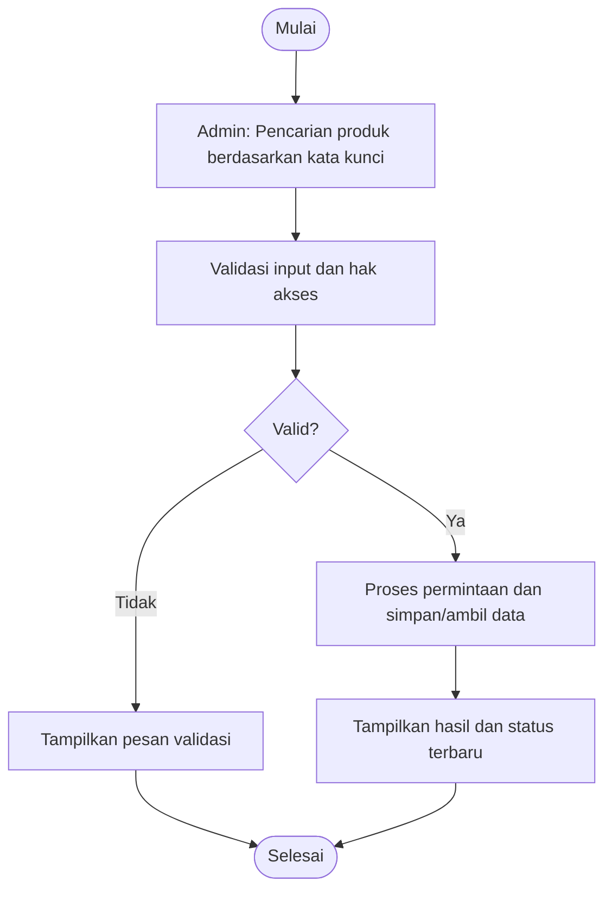

### TC-08 --- Filter produk berdasarkan kategori

**Aktor:** Admin\
**Prasyarat:** Kategori dan produk aktif tersedia.\
**Langkah pengujian:** 1. Buka filter kategori. 2. Pilih kategori.

**Data uji:** Kategori: Makanan Kucing.\
**Hasil yang diharapkan:** Daftar hanya menampilkan produk aktif pada
kategori terpilih.


### TC-09 --- Pelanggan melihat detail produk

**Aktor:** Admin\
**Prasyarat:** Produk aktif tersedia.\
**Langkah pengujian:** 1. Pilih salah satu produk dari katalog. 2. Buka
detail.

**Data uji:** ID produk aktif.\
**Hasil yang diharapkan:** Detail memuat deskripsi, harga, foto,
kategori, dan stok tersedia.

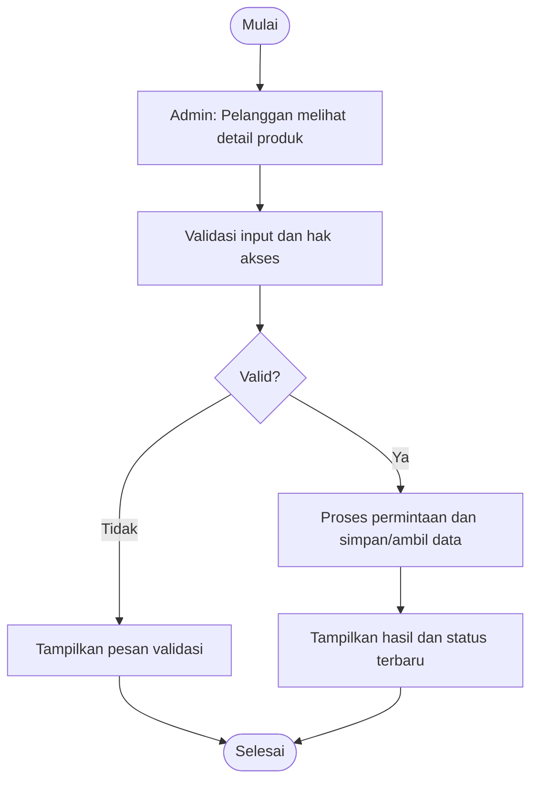

### TC-10 --- Admin menambahkan produk baru

**Aktor:** Admin\
**Prasyarat:** Admin login dan memiliki izin pengelolaan produk.\
**Langkah pengujian:** 1. Buka manajemen produk. 2. Pilih Tambah. 3. Isi
data valid. 4. Simpan.

**Data uji:** Nama, SKU unik, harga positif, stok bilangan bulat
nonnegatif.\
**Hasil yang diharapkan:** Produk tersimpan dan muncul di daftar katalog
sesuai status aktif.

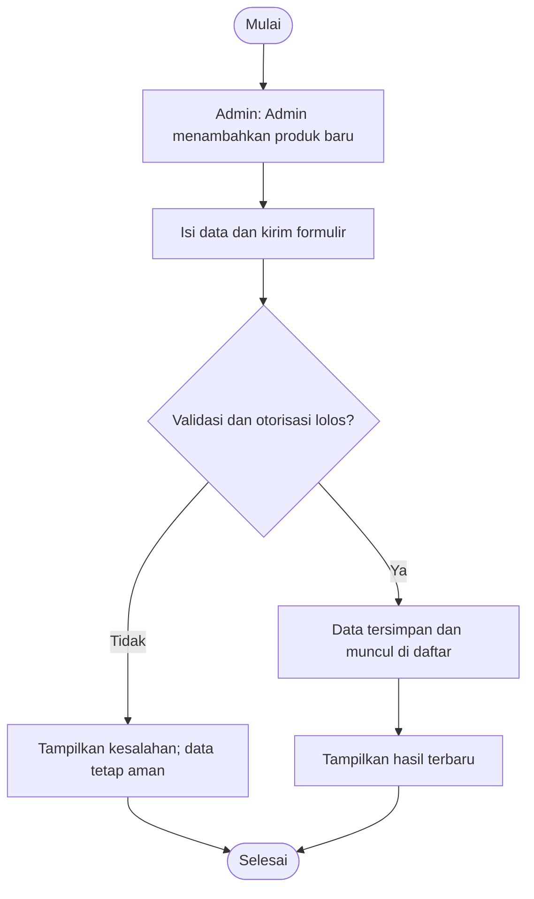

### TC-11 --- Admin menolak produk dengan harga negatif

**Aktor:** Admin\
**Prasyarat:** Admin login.\
**Langkah pengujian:** 1. Buka formulir produk. 2. Isi harga negatif. 3.
Simpan.

**Data uji:** Harga: -1000.\
**Hasil yang diharapkan:** Validasi menolak data; tidak ada produk baru
yang tersimpan.

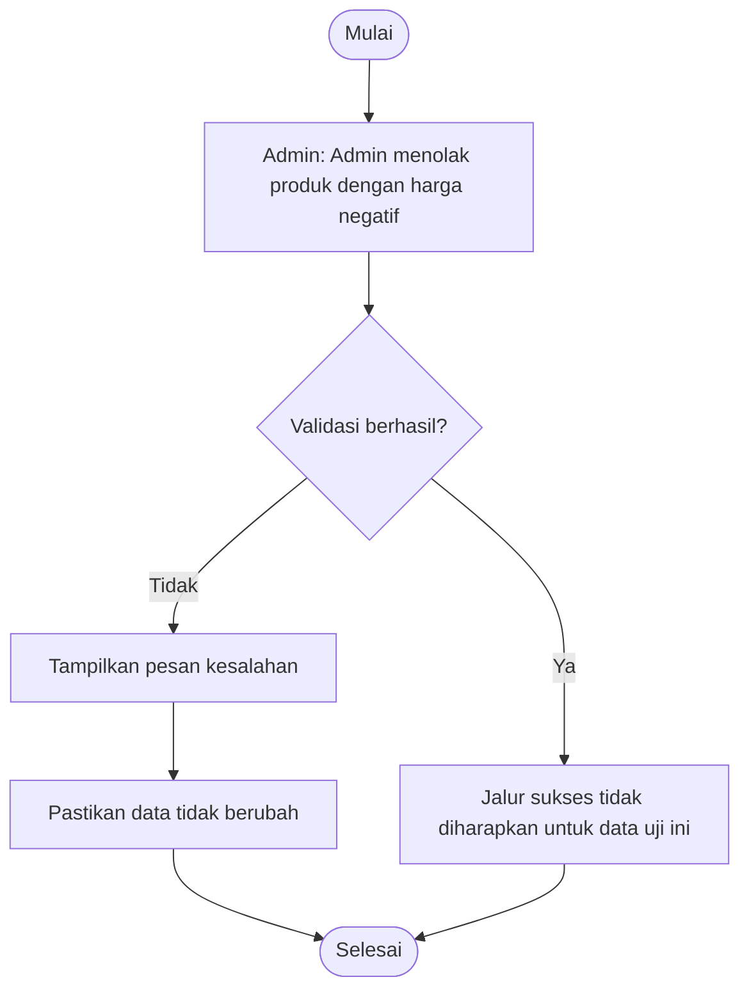

### TC-12 --- Admin menolak SKU duplikat

**Aktor:** Admin\
**Prasyarat:** Sudah ada produk dengan SKU yang sama.\
**Langkah pengujian:** 1. Tambah produk. 2. Gunakan SKU yang telah
terdaftar. 3. Simpan.

**Data uji:** SKU: PET-001 yang sudah digunakan.\
**Hasil yang diharapkan:** Sistem menolak duplikasi SKU dan menampilkan
pesan yang jelas.

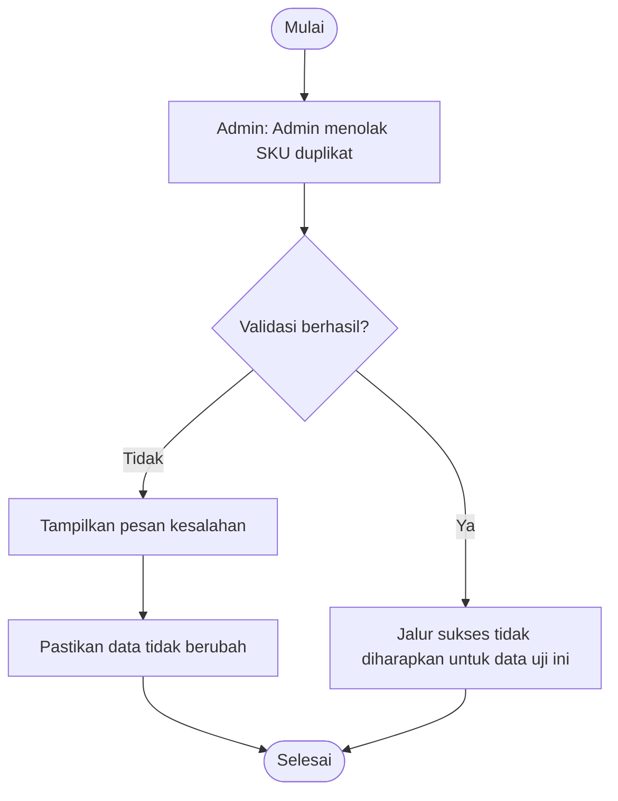

### TC-13 --- Admin melihat daftar produk

**Aktor:** Admin\
**Prasyarat:** Admin login dan data produk tersedia.\
**Langkah pengujian:** 1. Buka manajemen produk. 2. Periksa daftar dan
pagination.

**Data uji:** Data produk dengan beberapa halaman.\
**Hasil yang diharapkan:** Daftar produk tampil konsisten; pagination
tidak menghilangkan atau menggandakan data.

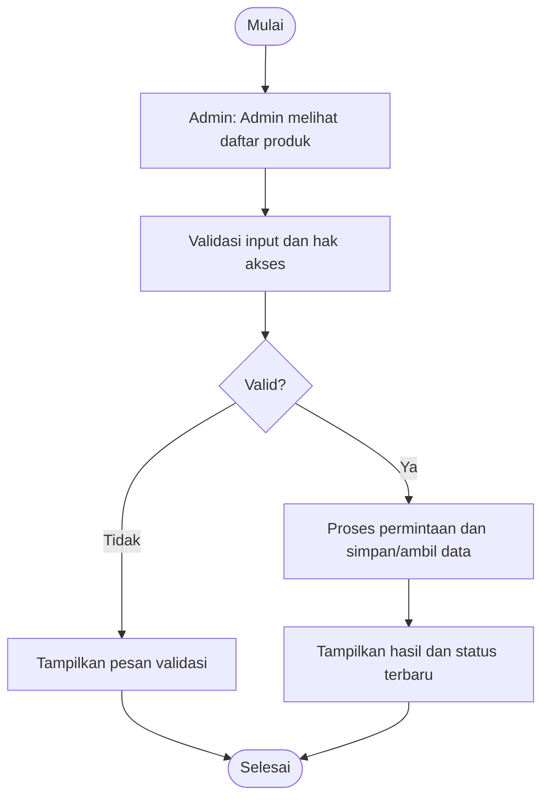

### TC-14 --- Admin mengubah informasi produk

**Aktor:** Admin\
**Prasyarat:** Produk target tersedia dan admin berizin.\
**Langkah pengujian:** 1. Pilih produk. 2. Ubah deskripsi atau harga. 3.
Simpan.

**Data uji:** Harga baru: 45000; deskripsi baru.\
**Hasil yang diharapkan:** Perubahan tersimpan dan tampil di daftar
serta detail produk.

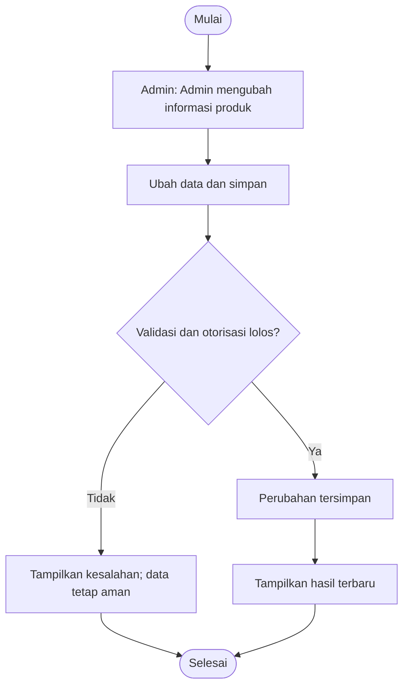

### TC-15 --- Admin menonaktifkan produk yang sudah pernah dipesan

**Aktor:** Admin\
**Prasyarat:** Produk pernah masuk riwayat pesanan.\
**Langkah pengujian:** 1. Buka produk. 2. Ubah status menjadi tidak
aktif. 3. Simpan.

**Data uji:** Produk dengan riwayat transaksi.\
**Hasil yang diharapkan:** Produk tidak muncul di katalog baru tetapi
tetap tersedia di riwayat pesanan.


### TC-16 --- Admin menghapus produk yang belum pernah digunakan

**Aktor:** Admin\
**Prasyarat:** Produk tidak memiliki relasi transaksi dan admin
berizin.\
**Langkah pengujian:** 1. Pilih produk. 2. Tekan Hapus. 3. Konfirmasi.

**Data uji:** Produk uji tanpa relasi.\
**Hasil yang diharapkan:** Produk dihapus atau diarsipkan sesuai
kebijakan; daftar diperbarui.


### TC-17 --- Admin membatalkan penghapusan produk

**Aktor:** Admin\
**Prasyarat:** Dialog konfirmasi penghapusan terbuka.\
**Langkah pengujian:** 1. Pilih Hapus. 2. Pilih Batal.

**Data uji:** Produk uji.\
**Hasil yang diharapkan:** Produk tetap tersimpan dan tidak berubah.

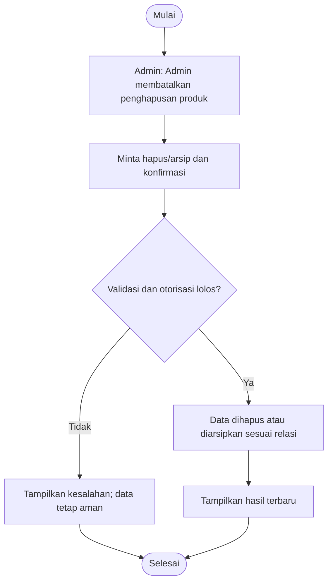

### TC-18 --- Admin membuat kategori baru

**Aktor:** Admin\
**Prasyarat:** Admin login.\
**Langkah pengujian:** 1. Buka manajemen kategori. 2. Tambah nama
kategori. 3. Simpan.

**Data uji:** Nama: Aksesori Hewan.\
**Hasil yang diharapkan:** Kategori tersimpan dan tersedia pada formulir
produk.

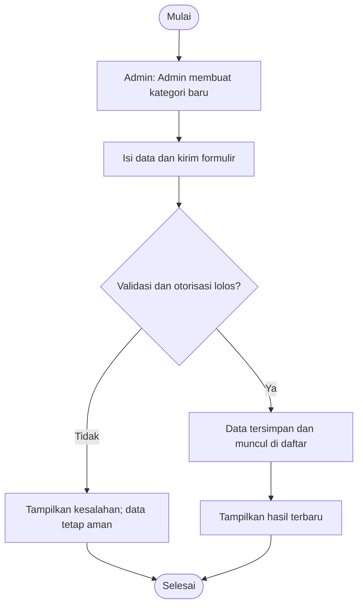

### TC-19 --- Admin mengubah nama kategori

**Aktor:** Admin\
**Prasyarat:** Kategori tersedia dan tidak ada konflik nama.\
**Langkah pengujian:** 1. Pilih kategori. 2. Ubah nama. 3. Simpan.

**Data uji:** Nama baru: Perawatan Hewan.\
**Hasil yang diharapkan:** Nama kategori diperbarui; relasi produk tetap
terjaga.

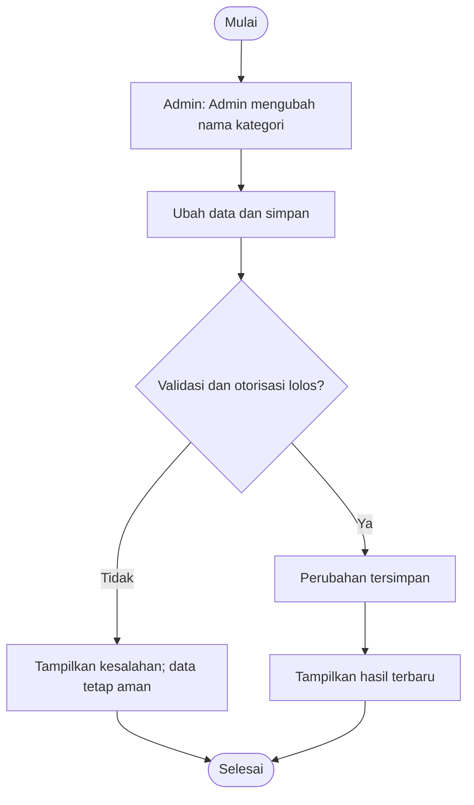

### TC-20 --- Admin mencegah penghapusan kategori yang masih digunakan

**Aktor:** Admin\
**Prasyarat:** Kategori memiliki produk terkait.\
**Langkah pengujian:** 1. Pilih kategori. 2. Tekan Hapus. 3. Konfirmasi.

**Data uji:** Kategori dengan produk terkait.\
**Hasil yang diharapkan:** Sistem menolak penghapusan atau meminta
pemindahan produk terlebih dahulu; tidak ada relasi yatim.

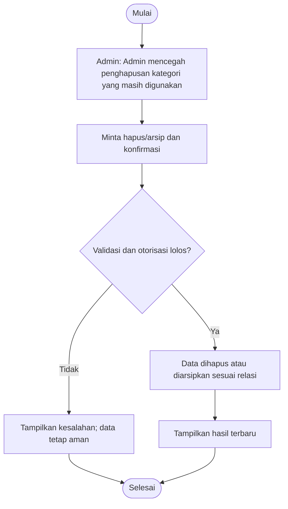

### TC-21 --- Pelanggan menambahkan produk ke keranjang

**Aktor:** Admin\
**Prasyarat:** Pelanggan login dan produk aktif memiliki stok.\
**Langkah pengujian:** 1. Buka detail produk. 2. Tentukan jumlah. 3.
Tambahkan ke keranjang.

**Data uji:** Produk aktif; jumlah 2.\
**Hasil yang diharapkan:** Item masuk ke keranjang dengan subtotal yang
dihitung dari harga terkini.

``` mermaid
flowchart TD
    A([Mulai]) --> B["Admin: Pelanggan menambahkan produk ke keranjang"]
    B --> C["Validasi sesi, keranjang, status, dan stok"]
    C --> D{"Permintaan sah?"}
    D -- Tidak --> E["Tolak permintaan dan tampilkan alasan"]
    E --> H([Selesai])
    D -- Ya --> F["Jalankan perubahan pesanan secara atomik"]
    F --> G["Simpan status, total, dan riwayat yang diperlukan"]
    G --> H
```

### TC-22 --- Pelanggan mengubah jumlah item keranjang

**Aktor:** Pelanggan\
**Prasyarat:** Keranjang berisi produk aktif.\
**Langkah pengujian:** 1. Buka keranjang. 2. Ubah jumlah. 3. Simpan
perubahan.

**Data uji:** Jumlah baru: 3; stok mencukupi.\
**Hasil yang diharapkan:** Jumlah dan subtotal diperbarui dengan benar.

``` mermaid
flowchart TD
    A([Mulai]) --> B["Pelanggan: Pelanggan mengubah jumlah item keranjang"]
    B --> C["Validasi sesi, keranjang, status, dan stok"]
    C --> D{"Permintaan sah?"}
    D -- Tidak --> E["Tolak permintaan dan tampilkan alasan"]
    E --> H([Selesai])
    D -- Ya --> F["Jalankan perubahan pesanan secara atomik"]
    F --> G["Simpan status, total, dan riwayat yang diperlukan"]
    G --> H
```

### TC-23 --- Pelanggan menghapus item dari keranjang

**Aktor:** Pelanggan\
**Prasyarat:** Keranjang berisi setidaknya satu item.\
**Langkah pengujian:** 1. Buka keranjang. 2. Hapus salah satu item. 3.
Konfirmasi bila diminta.

**Data uji:** Item dalam keranjang.\
**Hasil yang diharapkan:** Item hilang dari keranjang dan total dihitung
ulang.

``` mermaid
flowchart TD
    A([Mulai]) --> B["Pelanggan: Pelanggan menghapus item dari keranjang"]
    B --> C["Minta hapus/arsip dan konfirmasi"]
    C --> D{"Validasi dan otorisasi lolos?"}
    D -- Tidak --> E["Tampilkan kesalahan; data tetap aman"]
    E --> G([Selesai])
    D -- Ya --> F["Data dihapus atau diarsipkan sesuai relasi"]
    F --> H["Tampilkan hasil terbaru"]
    H --> G
```

### TC-24 --- Sistem menolak jumlah keranjang melebihi stok

**Aktor:** Admin/petugas berizin\
**Prasyarat:** Produk memiliki stok terbatas.\
**Langkah pengujian:** 1. Masukkan jumlah lebih besar dari stok. 2.
Tambahkan atau perbarui keranjang.

**Data uji:** Stok 3; jumlah diminta 5.\
**Hasil yang diharapkan:** Sistem menolak jumlah berlebih dan memberi
tahu batas stok.

``` mermaid
flowchart TD
    A([Mulai]) --> B["Admin/petugas berizin: Sistem menolak jumlah keranjang melebihi stok"]
    B --> C{"Validasi berhasil?"}
    C -- Tidak --> D["Tampilkan pesan kesalahan"]
    D --> E["Pastikan data tidak berubah"]
    E --> F([Selesai])
    C -- Ya --> G["Jalur sukses tidak diharapkan untuk data uji ini"]
    G --> F
```

### TC-25 --- Pelanggan checkout dengan data valid

**Aktor:** Pelanggan\
**Prasyarat:** Pelanggan login; keranjang tidak kosong; stok mencukupi.\
**Langkah pengujian:** 1. Buka checkout. 2. Isi alamat dan kontak. 3.
Tinjau ringkasan. 4. Konfirmasi pesanan.

**Data uji:** Satu atau lebih item; alamat lengkap.\
**Hasil yang diharapkan:** Pesanan dibuat dengan snapshot harga, total
akurat, dan status menunggu pembayaran.

``` mermaid
flowchart TD
    A([Mulai]) --> B["Pelanggan: Pelanggan checkout dengan data valid"]
    B --> C["Validasi sesi, keranjang, status, dan stok"]
    C --> D{"Permintaan sah?"}
    D -- Tidak --> E["Tolak permintaan dan tampilkan alasan"]
    E --> H([Selesai])
    D -- Ya --> F["Jalankan perubahan pesanan secara atomik"]
    F --> G["Simpan status, total, dan riwayat yang diperlukan"]
    G --> H
```

### TC-26 --- Checkout ditolak jika keranjang kosong

**Aktor:** Pelanggan\
**Prasyarat:** Pelanggan login dan keranjang kosong.\
**Langkah pengujian:** 1. Buka URL atau halaman checkout. 2. Coba
konfirmasi pesanan.

**Data uji:** Keranjang kosong.\
**Hasil yang diharapkan:** Pesanan tidak dibuat; pengguna diarahkan
kembali ke katalog atau keranjang.

``` mermaid
flowchart TD
    A([Mulai]) --> B["Pelanggan: Checkout ditolak jika keranjang kosong"]
    B --> C{"Validasi berhasil?"}
    C -- Tidak --> D["Tampilkan pesan kesalahan"]
    D --> E["Pastikan data tidak berubah"]
    E --> F([Selesai])
    C -- Ya --> G["Jalur sukses tidak diharapkan untuk data uji ini"]
    G --> F
```

### TC-27 --- Checkout menolak stok yang berubah menjadi tidak cukup

**Aktor:** Admin/petugas berizin\
**Prasyarat:** Keranjang berisi produk; stok berubah sebelum checkout.\
**Langkah pengujian:** 1. Masukkan produk ke keranjang. 2. Ubah stok di
sesi admin hingga kurang. 3. Checkout.

**Data uji:** Jumlah 2; stok terkini 1.\
**Hasil yang diharapkan:** Transaksi checkout dibatalkan secara atomik;
stok tidak negatif dan pengguna menerima pesan.

``` mermaid
flowchart TD
    A([Mulai]) --> B["Admin/petugas berizin: Checkout menolak stok yang berubah menjadi tidak cukup"]
    B --> C["Baca stok terkini dan validasi kuantitas"]
    C --> D{"Stok cukup dan data valid?"}
    D -- Tidak --> E["Batalkan operasi; stok tetap konsisten"]
    E --> H([Selesai])
    D -- Ya --> F["Perbarui stok secara atomik"]
    F --> G["Catat mutasi stok dan referensi"]
    G --> H
```

### TC-28 --- Pelanggan melihat riwayat pesanan sendiri

**Aktor:** Pelanggan\
**Prasyarat:** Pelanggan login dan memiliki pesanan.\
**Langkah pengujian:** 1. Buka Pesanan Saya. 2. Pilih pesanan.

**Data uji:** Akun pelanggan dengan riwayat.\
**Hasil yang diharapkan:** Hanya pesanan milik pelanggan tersebut yang
ditampilkan beserta status dan total.

``` mermaid
flowchart TD
    A([Mulai]) --> B["Pelanggan: Pelanggan melihat riwayat pesanan sendiri"]
    B --> C["Validasi input dan hak akses"]
    C --> D{"Valid?"}
    D -- Tidak --> E["Tampilkan pesan validasi"]
    E --> F([Selesai])
    D -- Ya --> G["Proses permintaan dan simpan/ambil data"]
    G --> H["Tampilkan hasil dan status terbaru"]
    H --> F
```

### TC-29 --- Pelanggan melihat detail pesanan

**Aktor:** Pelanggan\
**Prasyarat:** Pesanan dimiliki pelanggan yang login.\
**Langkah pengujian:** 1. Buka riwayat. 2. Pilih satu pesanan.

**Data uji:** ID pesanan milik pengguna.\
**Hasil yang diharapkan:** Rincian item, snapshot harga, alamat, total,
dan status tampil benar.

``` mermaid
flowchart TD
    A([Mulai]) --> B["Pelanggan: Pelanggan melihat detail pesanan"]
    B --> C["Validasi input dan hak akses"]
    C --> D{"Valid?"}
    D -- Tidak --> E["Tampilkan pesan validasi"]
    E --> F([Selesai])
    D -- Ya --> G["Proses permintaan dan simpan/ambil data"]
    G --> H["Tampilkan hasil dan status terbaru"]
    H --> F
```

### TC-30 --- Pelanggan membatalkan pesanan yang belum diproses

**Aktor:** Pelanggan\
**Prasyarat:** Pesanan masih berstatus menunggu pembayaran dan belum
dibayar.\
**Langkah pengujian:** 1. Buka detail pesanan. 2. Pilih Batalkan. 3.
Konfirmasi.

**Data uji:** Pesanan eligible untuk dibatalkan.\
**Hasil yang diharapkan:** Status menjadi dibatalkan; reservasi stok
dilepas satu kali.

``` mermaid
flowchart TD
    A([Mulai]) --> B["Pelanggan: Pelanggan membatalkan pesanan yang belum diproses"]
    B --> C["Validasi sesi, keranjang, status, dan stok"]
    C --> D{"Permintaan sah?"}
    D -- Tidak --> E["Tolak permintaan dan tampilkan alasan"]
    E --> H([Selesai])
    D -- Ya --> F["Jalankan perubahan pesanan secara atomik"]
    F --> G["Simpan status, total, dan riwayat yang diperlukan"]
    G --> H
```

### TC-31 --- Sistem menolak pembatalan pesanan yang sudah dikirim

**Aktor:** Pengguna\
**Prasyarat:** Pesanan berstatus dikirim.\
**Langkah pengujian:** 1. Buka detail pesanan. 2. Coba batalkan.

**Data uji:** Status: dikirim.\
**Hasil yang diharapkan:** Pembatalan ditolak; status dan stok tidak
berubah.

``` mermaid
flowchart TD
    A([Mulai]) --> B["Pengguna: Sistem menolak pembatalan pesanan yang sudah dikirim"]
    B --> C{"Validasi berhasil?"}
    C -- Tidak --> D["Tampilkan pesan kesalahan"]
    D --> E["Pastikan data tidak berubah"]
    E --> F([Selesai])
    C -- Ya --> G["Jalur sukses tidak diharapkan untuk data uji ini"]
    G --> F
```

### TC-32 --- Admin melihat semua pesanan

**Aktor:** Admin/petugas berizin\
**Prasyarat:** Admin login dan pesanan tersedia.\
**Langkah pengujian:** 1. Buka manajemen pesanan. 2. Gunakan filter
status.

**Data uji:** Pesanan dari beberapa pelanggan.\
**Hasil yang diharapkan:** Admin dapat melihat daftar sesuai izin dengan
status dan data ringkas yang akurat.

``` mermaid
flowchart TD
    A([Mulai]) --> B["Admin/petugas berizin: Admin melihat semua pesanan"]
    B --> C["Validasi input dan hak akses"]
    C --> D{"Valid?"}
    D -- Tidak --> E["Tampilkan pesan validasi"]
    E --> F([Selesai])
    D -- Ya --> G["Proses permintaan dan simpan/ambil data"]
    G --> H["Tampilkan hasil dan status terbaru"]
    H --> F
```

### TC-33 --- Admin memperbarui status pesanan secara sah

**Aktor:** Admin/petugas berizin\
**Prasyarat:** Pesanan menunggu diproses.\
**Langkah pengujian:** 1. Buka detail pesanan. 2. Ubah status ke
diproses. 3. Simpan.

**Data uji:** Status awal menunggu diproses.\
**Hasil yang diharapkan:** Perubahan status sah tersimpan dan tercatat
dalam riwayat status.

``` mermaid
flowchart TD
    A([Mulai]) --> B["Admin/petugas berizin: Admin memperbarui status pesanan secara sah"]
    B --> C["Ubah data dan simpan"]
    C --> D{"Validasi dan otorisasi lolos?"}
    D -- Tidak --> E["Tampilkan kesalahan; data tetap aman"]
    E --> G([Selesai])
    D -- Ya --> F["Perubahan tersimpan"]
    F --> H["Tampilkan hasil terbaru"]
    H --> G
```

### TC-34 --- Sistem menolak lompatan status pesanan tidak sah

**Aktor:** Pengguna\
**Prasyarat:** Pesanan belum diproses.\
**Langkah pengujian:** 1. Coba ubah status langsung menjadi selesai. 2.
Simpan.

**Data uji:** Status awal menunggu pembayaran.\
**Hasil yang diharapkan:** Perubahan tidak sah ditolak dan status lama
tetap tersimpan.

``` mermaid
flowchart TD
    A([Mulai]) --> B["Pengguna: Sistem menolak lompatan status pesanan tidak sah"]
    B --> C{"Validasi berhasil?"}
    C -- Tidak --> D["Tampilkan pesan kesalahan"]
    D --> E["Pastikan data tidak berubah"]
    E --> F([Selesai])
    C -- Ya --> G["Jalur sukses tidak diharapkan untuk data uji ini"]
    G --> F
```

### TC-35 --- Admin memasukkan nomor resi saat mengirim pesanan

**Aktor:** Admin/petugas berizin\
**Prasyarat:** Pesanan telah dibayar dan diproses.\
**Langkah pengujian:** 1. Buka detail pesanan. 2. Pilih status dikirim.
3. Masukkan nomor resi. 4. Simpan.

**Data uji:** Resi: RESI-TEST-123.\
**Hasil yang diharapkan:** Status menjadi dikirim dan nomor resi
tersimpan serta dapat dilihat pelanggan terkait.

``` mermaid
flowchart TD
    A([Mulai]) --> B["Admin/petugas berizin: Admin memasukkan nomor resi saat mengirim pesanan"]
    B --> C["Ubah data dan simpan"]
    C --> D{"Validasi dan otorisasi lolos?"}
    D -- Tidak --> E["Tampilkan kesalahan; data tetap aman"]
    E --> G([Selesai])
    D -- Ya --> F["Perubahan tersimpan"]
    F --> H["Tampilkan hasil terbaru"]
    H --> G
```

### TC-36 --- Pelanggan mengonfirmasi pesanan diterima

**Aktor:** Pelanggan\
**Prasyarat:** Pesanan berstatus dikirim dan dimiliki pelanggan.\
**Langkah pengujian:** 1. Buka detail pesanan. 2. Pilih Pesanan
Diterima. 3. Konfirmasi.

**Data uji:** Pesanan dikirim milik pelanggan.\
**Hasil yang diharapkan:** Status menjadi selesai; aksi hanya dapat
dilakukan oleh pemilik pesanan.

``` mermaid
flowchart TD
    A([Mulai]) --> B["Pelanggan: Pelanggan mengonfirmasi pesanan diterima"]
    B --> C["Validasi sesi, keranjang, status, dan stok"]
    C --> D{"Permintaan sah?"}
    D -- Tidak --> E["Tolak permintaan dan tampilkan alasan"]
    E --> H([Selesai])
    D -- Ya --> F["Jalankan perubahan pesanan secara atomik"]
    F --> G["Simpan status, total, dan riwayat yang diperlukan"]
    G --> H
```

### TC-37 --- Pelanggan mengunggah bukti transfer dummy

**Aktor:** Pelanggan\
**Prasyarat:** Pesanan menunggu pembayaran dan pelanggan pemilik pesanan
login.\
**Langkah pengujian:** 1. Buka halaman pembayaran. 2. Pilih gambar bukti
dummy. 3. Kirim bukti.

**Data uji:** File JPG/PNG valid; ukuran sesuai batas.\
**Hasil yang diharapkan:** File tersimpan di bucket privat; pembayaran
menjadi menunggu verifikasi.

``` mermaid
flowchart TD
    A([Mulai]) --> B["Pelanggan: Pelanggan mengunggah bukti transfer dummy"]
    B --> C["Periksa kepemilikan, status, dan data bukti"]
    C --> D{"Valid dan diizinkan?"}
    D -- Tidak --> E["Tolak operasi; catat kegagalan yang relevan"]
    E --> H([Selesai])
    D -- Ya --> F["Simpan perubahan pembayaran secara aman"]
    F --> G["Catat aktor, waktu, dan riwayat status"]
    G --> H
```

### TC-38 --- Sistem menolak file bukti pembayaran dengan tipe tidak diizinkan

**Aktor:** Pelanggan\
**Prasyarat:** Pesanan menunggu pembayaran.\
**Langkah pengujian:** 1. Pilih file dengan ekstensi atau MIME tidak
diizinkan. 2. Kirim bukti.

**Data uji:** File executable atau format tidak didukung.\
**Hasil yang diharapkan:** Unggahan ditolak; file tidak disimpan dan
status pembayaran tidak berubah.

``` mermaid
flowchart TD
    A([Mulai]) --> B["Pelanggan: Sistem menolak file bukti pembayaran dengan tipe tidak diizinkan"]
    B --> C{"Validasi berhasil?"}
    C -- Tidak --> D["Tampilkan pesan kesalahan"]
    D --> E["Pastikan data tidak berubah"]
    E --> F([Selesai])
    C -- Ya --> G["Jalur sukses tidak diharapkan untuk data uji ini"]
    G --> F
```

### TC-39 --- Sistem menolak bukti pembayaran yang melebihi batas ukuran

**Aktor:** Pelanggan\
**Prasyarat:** Pesanan menunggu pembayaran.\
**Langkah pengujian:** 1. Pilih file yang terlalu besar. 2. Kirim bukti.

**Data uji:** Ukuran melebihi batas yang ditetapkan.\
**Hasil yang diharapkan:** Unggahan ditolak dengan pesan ukuran
maksimum; tidak ada perubahan status.

``` mermaid
flowchart TD
    A([Mulai]) --> B["Pelanggan: Sistem menolak bukti pembayaran yang melebihi batas ukuran"]
    B --> C{"Validasi berhasil?"}
    C -- Tidak --> D["Tampilkan pesan kesalahan"]
    D --> E["Pastikan data tidak berubah"]
    E --> F([Selesai])
    C -- Ya --> G["Jalur sukses tidak diharapkan untuk data uji ini"]
    G --> F
```

### TC-40 --- Pelanggan mengganti bukti sebelum diverifikasi

**Aktor:** Admin/petugas berizin\
**Prasyarat:** Pembayaran berstatus menunggu verifikasi dan kebijakan
mengizinkan penggantian.\
**Langkah pengujian:** 1. Buka pembayaran. 2. Unggah bukti baru. 3.
Simpan.

**Data uji:** Bukti baru valid.\
**Hasil yang diharapkan:** Bukti terbaru menjadi bukti aktif; akses
bukti lama ditangani sesuai kebijakan retensi.

``` mermaid
flowchart TD
    A([Mulai]) --> B["Admin/petugas berizin: Pelanggan mengganti bukti sebelum diverifikasi"]
    B --> C["Periksa kepemilikan, status, dan data bukti"]
    C --> D{"Valid dan diizinkan?"}
    D -- Tidak --> E["Tolak operasi; catat kegagalan yang relevan"]
    E --> H([Selesai])
    D -- Ya --> F["Simpan perubahan pembayaran secara aman"]
    F --> G["Catat aktor, waktu, dan riwayat status"]
    G --> H
```

### TC-41 --- Admin melihat antrean verifikasi pembayaran

**Aktor:** Admin/petugas berizin\
**Prasyarat:** Admin login dan ada pembayaran menunggu verifikasi.\
**Langkah pengujian:** 1. Buka menu Verifikasi Pembayaran. 2. Pilih
transaksi.

**Data uji:** Pembayaran berstatus menunggu verifikasi.\
**Hasil yang diharapkan:** Antrean menampilkan transaksi relevan tanpa
mengekspos bukti ke pelanggan lain.

``` mermaid
flowchart TD
    A([Mulai]) --> B["Admin/petugas berizin: Admin melihat antrean verifikasi pembayaran"]
    B --> C["Validasi input dan hak akses"]
    C --> D{"Valid?"}
    D -- Tidak --> E["Tampilkan pesan validasi"]
    E --> F([Selesai])
    D -- Ya --> G["Proses permintaan dan simpan/ambil data"]
    G --> H["Tampilkan hasil dan status terbaru"]
    H --> F
```

### TC-42 --- Admin menyetujui bukti pembayaran

**Aktor:** Admin\
**Prasyarat:** Bukti valid dan pembayaran menunggu verifikasi.\
**Langkah pengujian:** 1. Buka transaksi. 2. Periksa bukti. 3. Pilih
Setujui.

**Data uji:** Pembayaran simulasi dengan bukti dummy.\
**Hasil yang diharapkan:** Status pembayaran menjadi disetujui; pesanan
beralih ke siap diproses sesuai aturan; tidak ada gateway nyata.

``` mermaid
flowchart TD
    A([Mulai]) --> B["Admin: Admin menyetujui bukti pembayaran"]
    B --> C["Periksa kepemilikan, status, dan data bukti"]
    C --> D{"Valid dan diizinkan?"}
    D -- Tidak --> E["Tolak operasi; catat kegagalan yang relevan"]
    E --> H([Selesai])
    D -- Ya --> F["Simpan perubahan pembayaran secara aman"]
    F --> G["Catat aktor, waktu, dan riwayat status"]
    G --> H
```

### TC-43 --- Admin menolak bukti pembayaran dengan alasan

**Aktor:** Admin\
**Prasyarat:** Pembayaran menunggu verifikasi dan bukti tidak valid
untuk simulasi.\
**Langkah pengujian:** 1. Buka transaksi. 2. Pilih Tolak. 3. Masukkan
alasan. 4. Simpan.

**Data uji:** Alasan: bukti tidak terbaca.\
**Hasil yang diharapkan:** Status menjadi ditolak; alasan tersimpan dan
pelanggan dapat melihat instruksi mengunggah ulang.

``` mermaid
flowchart TD
    A([Mulai]) --> B["Admin: Admin menolak bukti pembayaran dengan alasan"]
    B --> C["Periksa kepemilikan, status, dan data bukti"]
    C --> D{"Valid dan diizinkan?"}
    D -- Tidak --> E["Tolak operasi; catat kegagalan yang relevan"]
    E --> H([Selesai])
    D -- Ya --> F["Simpan perubahan pembayaran secara aman"]
    F --> G["Catat aktor, waktu, dan riwayat status"]
    G --> H
```

### TC-44 --- Sistem mencegah verifikasi pembayaran dua kali

**Aktor:** Admin/petugas berizin\
**Prasyarat:** Pembayaran sudah disetujui.\
**Langkah pengujian:** 1. Buka transaksi yang sama. 2. Coba setujui
kembali.

**Data uji:** Status awal disetujui.\
**Hasil yang diharapkan:** Operasi kedua ditolak atau idempoten; tidak
menggandakan perubahan status atau efek stok.

``` mermaid
flowchart TD
    A([Mulai]) --> B["Admin/petugas berizin: Sistem mencegah verifikasi pembayaran dua kali"]
    B --> C{"Validasi berhasil?"}
    C -- Tidak --> D["Tampilkan pesan kesalahan"]
    D --> E["Pastikan data tidak berubah"]
    E --> F([Selesai])
    C -- Ya --> G["Jalur sukses tidak diharapkan untuk data uji ini"]
    G --> F
```

### TC-45 --- Pelanggan melihat status pembayaran

**Aktor:** Pelanggan\
**Prasyarat:** Pelanggan memiliki pesanan dengan pembayaran.\
**Langkah pengujian:** 1. Buka detail pesanan. 2. Lihat bagian
pembayaran.

**Data uji:** Status menunggu verifikasi, disetujui, atau ditolak.\
**Hasil yang diharapkan:** Pelanggan hanya melihat status dan bukti
miliknya sendiri serta alasan penolakan bila ada.

``` mermaid
flowchart TD
    A([Mulai]) --> B["Pelanggan: Pelanggan melihat status pembayaran"]
    B --> C["Validasi input dan hak akses"]
    C --> D{"Valid?"}
    D -- Tidak --> E["Tampilkan pesan validasi"]
    E --> F([Selesai])
    D -- Ya --> G["Proses permintaan dan simpan/ambil data"]
    G --> H["Tampilkan hasil dan status terbaru"]
    H --> F
```

### TC-46 --- Admin menyesuaikan stok melalui penerimaan barang

**Aktor:** Admin/petugas berizin\
**Prasyarat:** Admin login dan produk tersedia.\
**Langkah pengujian:** 1. Buka inventaris. 2. Pilih produk. 3. Masukkan
jumlah penerimaan. 4. Simpan.

**Data uji:** Penerimaan: 10 unit.\
**Hasil yang diharapkan:** Stok bertambah sesuai jumlah dan mutasi
inventaris tercatat.

``` mermaid
flowchart TD
    A([Mulai]) --> B["Admin/petugas berizin: Admin menyesuaikan stok melalui penerimaan barang"]
    B --> C["Baca stok terkini dan validasi kuantitas"]
    C --> D{"Stok cukup dan data valid?"}
    D -- Tidak --> E["Batalkan operasi; stok tetap konsisten"]
    E --> H([Selesai])
    D -- Ya --> F["Perbarui stok secara atomik"]
    F --> G["Catat mutasi stok dan referensi"]
    G --> H
```

### TC-47 --- Admin mencatat penyesuaian stok negatif yang sah

**Aktor:** Admin/petugas berizin\
**Prasyarat:** Admin berizin dan stok cukup untuk penyesuaian.\
**Langkah pengujian:** 1. Buka inventaris. 2. Pilih penyesuaian keluar.
3. Masukkan jumlah dan alasan. 4. Simpan.

**Data uji:** Penyesuaian keluar: 2; alasan: barang rusak.\
**Hasil yang diharapkan:** Stok berkurang dan alasan tercatat; stok
tidak boleh menjadi negatif.

``` mermaid
flowchart TD
    A([Mulai]) --> B["Admin/petugas berizin: Admin mencatat penyesuaian stok negatif yang sah"]
    B --> C["Baca stok terkini dan validasi kuantitas"]
    C --> D{"Stok cukup dan data valid?"}
    D -- Tidak --> E["Batalkan operasi; stok tetap konsisten"]
    E --> H([Selesai])
    D -- Ya --> F["Perbarui stok secara atomik"]
    F --> G["Catat mutasi stok dan referensi"]
    G --> H
```

### TC-48 --- Sistem menolak penyesuaian yang membuat stok negatif

**Aktor:** Admin/petugas berizin\
**Prasyarat:** Stok produk lebih kecil dari jumlah penyesuaian keluar.\
**Langkah pengujian:** 1. Masukkan jumlah keluar melebihi stok. 2.
Simpan.

**Data uji:** Stok 2; penyesuaian keluar 5.\
**Hasil yang diharapkan:** Penyesuaian ditolak; stok tetap sama dan
mutasi gagal tidak dicatat sebagai sukses.

``` mermaid
flowchart TD
    A([Mulai]) --> B["Admin/petugas berizin: Sistem menolak penyesuaian yang membuat stok negatif"]
    B --> C{"Validasi berhasil?"}
    C -- Tidak --> D["Tampilkan pesan kesalahan"]
    D --> E["Pastikan data tidak berubah"]
    E --> F([Selesai])
    C -- Ya --> G["Jalur sukses tidak diharapkan untuk data uji ini"]
    G --> F
```

### TC-49 --- Sistem mencatat mutasi stok akibat pesanan

**Aktor:** Admin/petugas berizin\
**Prasyarat:** Checkout sukses dan kebijakan stok menggunakan
reservasi.\
**Langkah pengujian:** 1. Buat pesanan valid. 2. Periksa stok dan log
mutasi.

**Data uji:** Pesanan 2 unit.\
**Hasil yang diharapkan:** Stok tersedia/reservasi berubah tepat satu
kali sesuai kebijakan; log memuat referensi pesanan.

``` mermaid
flowchart TD
    A([Mulai]) --> B["Admin/petugas berizin: Sistem mencatat mutasi stok akibat pesanan"]
    B --> C["Baca stok terkini dan validasi kuantitas"]
    C --> D{"Stok cukup dan data valid?"}
    D -- Tidak --> E["Batalkan operasi; stok tetap konsisten"]
    E --> H([Selesai])
    D -- Ya --> F["Perbarui stok secara atomik"]
    F --> G["Catat mutasi stok dan referensi"]
    G --> H
```

### TC-50 --- Stok dikembalikan saat pesanan dibatalkan

**Aktor:** Admin/petugas berizin\
**Prasyarat:** Pesanan memiliki reservasi stok dan belum diproses.\
**Langkah pengujian:** 1. Batalkan pesanan. 2. Periksa stok dan mutasi.

**Data uji:** Pesanan berisi 2 unit.\
**Hasil yang diharapkan:** Stok/reservasi dikembalikan tepat satu kali;
pengulangan permintaan tidak menggandakan stok.

``` mermaid
flowchart TD
    A([Mulai]) --> B["Admin/petugas berizin: Stok dikembalikan saat pesanan dibatalkan"]
    B --> C["Baca stok terkini dan validasi kuantitas"]
    C --> D{"Stok cukup dan data valid?"}
    D -- Tidak --> E["Batalkan operasi; stok tetap konsisten"]
    E --> H([Selesai])
    D -- Ya --> F["Perbarui stok secara atomik"]
    F --> G["Catat mutasi stok dan referensi"]
    G --> H
```

### TC-51 --- Admin membuat akun petugas

**Aktor:** Admin/petugas berizin\
**Prasyarat:** Admin login dan memiliki izin pengelolaan pengguna.\
**Langkah pengujian:** 1. Buka manajemen pengguna. 2. Tambah petugas
dengan data valid. 3. Simpan.

**Data uji:** Nama dan email unik; peran petugas.\
**Hasil yang diharapkan:** Akun petugas dibuat dengan peran minimum yang
diperlukan.

``` mermaid
flowchart TD
    A([Mulai]) --> B["Admin/petugas berizin: Admin membuat akun petugas"]
    B --> C["Isi data dan kirim formulir"]
    C --> D{"Validasi dan otorisasi lolos?"}
    D -- Tidak --> E["Tampilkan kesalahan; data tetap aman"]
    E --> G([Selesai])
    D -- Ya --> F["Data tersimpan dan muncul di daftar"]
    F --> H["Tampilkan hasil terbaru"]
    H --> G
```

### TC-52 --- Admin mengubah peran pengguna

**Aktor:** Admin\
**Prasyarat:** Admin memiliki izin; pengguna target tersedia.\
**Langkah pengujian:** 1. Pilih pengguna. 2. Ubah peran sesuai
kewenangan. 3. Simpan.

**Data uji:** Peran pelanggan menjadi petugas.\
**Hasil yang diharapkan:** Peran diperbarui; akses mengikuti kebijakan
baru; perubahan penting tercatat.

``` mermaid
flowchart TD
    A([Mulai]) --> B["Admin: Admin mengubah peran pengguna"]
    B --> C["Ubah data dan simpan"]
    C --> D{"Validasi dan otorisasi lolos?"}
    D -- Tidak --> E["Tampilkan kesalahan; data tetap aman"]
    E --> G([Selesai])
    D -- Ya --> F["Perubahan tersimpan"]
    F --> H["Tampilkan hasil terbaru"]
    H --> G
```

### TC-53 --- Admin menonaktifkan akun petugas

**Aktor:** Admin/petugas berizin\
**Prasyarat:** Akun petugas tersedia dan admin berwenang.\
**Langkah pengujian:** 1. Buka detail pengguna. 2. Nonaktifkan akun. 3.
Konfirmasi.

**Data uji:** Petugas aktif.\
**Hasil yang diharapkan:** Akun tidak dapat login atau melakukan operasi
baru; data historis tetap dipertahankan.

``` mermaid
flowchart TD
    A([Mulai]) --> B["Admin/petugas berizin: Admin menonaktifkan akun petugas"]
    B --> C["Minta hapus/arsip dan konfirmasi"]
    C --> D{"Validasi dan otorisasi lolos?"}
    D -- Tidak --> E["Tampilkan kesalahan; data tetap aman"]
    E --> G([Selesai])
    D -- Ya --> F["Data dihapus atau diarsipkan sesuai relasi"]
    F --> H["Tampilkan hasil terbaru"]
    H --> G
```

### TC-54 --- Pelanggan tidak dapat membuka halaman admin

**Aktor:** Admin\
**Prasyarat:** Pelanggan login.\
**Langkah pengujian:** 1. Masukkan URL halaman admin secara langsung. 2.
Coba menjalankan operasi admin.

**Data uji:** Token pelanggan biasa.\
**Hasil yang diharapkan:** Akses ditolak di UI dan backend/RLS; tidak
ada data atau perubahan admin yang bocor.

``` mermaid
flowchart TD
    A([Mulai]) --> B["Admin: Pelanggan tidak dapat membuka halaman admin"]
    B --> C["Periksa sesi, peran, kepemilikan, dan RLS"]
    C --> D{"Akses diizinkan?"}
    D -- Tidak --> E["Tolak akses; jangan bocorkan data"]
    E --> F([Selesai])
    D -- Ya --> G["Kembalikan hanya data yang diizinkan"]
    G --> F
```

### TC-55 --- Pelanggan tidak dapat membaca pesanan pelanggan lain

**Aktor:** Pelanggan\
**Prasyarat:** Dua akun pelanggan dan pesanan masing-masing tersedia.\
**Langkah pengujian:** 1. Login sebagai pelanggan A. 2. Ubah ID pesanan
pada URL/API ke pesanan B.

**Data uji:** ID pesanan milik pelanggan B.\
**Hasil yang diharapkan:** Permintaan ditolak atau tidak menemukan data;
RLS mencegah akses lintas pengguna.

``` mermaid
flowchart TD
    A([Mulai]) --> B["Pelanggan: Pelanggan tidak dapat membaca pesanan pelanggan lain"]
    B --> C["Periksa sesi, peran, kepemilikan, dan RLS"]
    C --> D{"Akses diizinkan?"}
    D -- Tidak --> E["Tolak akses; jangan bocorkan data"]
    E --> F([Selesai])
    D -- Ya --> G["Kembalikan hanya data yang diizinkan"]
    G --> F
```

### TC-56 --- Validasi formulir menangani field wajib kosong

**Aktor:** Pengguna\
**Prasyarat:** Formulir produk atau kategori terbuka.\
**Langkah pengujian:** 1. Kosongkan field wajib. 2. Kirim formulir.

**Data uji:** Nama kosong; field wajib lain kosong.\
**Hasil yang diharapkan:** Validasi tampil; permintaan tidak membuat
atau mengubah data.

``` mermaid
flowchart TD
    A([Mulai]) --> B["Pengguna: Validasi formulir menangani field wajib kosong"]
    B --> C{"Validasi berhasil?"}
    C -- Tidak --> D["Tampilkan pesan kesalahan"]
    D --> E["Pastikan data tidak berubah"]
    E --> F([Selesai])
    C -- Ya --> G["Jalur sukses tidak diharapkan untuk data uji ini"]
    G --> F
```

### TC-57 --- Sistem menangani kegagalan koneksi database

**Aktor:** Pengguna\
**Prasyarat:** Aplikasi terbuka; simulasi koneksi Supabase gagal.\
**Langkah pengujian:** 1. Jalankan operasi baca atau simpan. 2. Amati
respons.

**Data uji:** Koneksi timeout atau server error.\
**Hasil yang diharapkan:** Pengguna mendapat pesan yang aman; aplikasi
tidak menampilkan rahasia dan tidak mengklaim operasi berhasil.

``` mermaid
flowchart TD
    A([Mulai]) --> B["Pengguna: Sistem menangani kegagalan koneksi database"]
    B --> C["Kirim permintaan ke Supabase"]
    C --> D{"Layanan merespons sukses?"}
    D -- Tidak --> E["Tampilkan pesan aman dan opsi coba lagi"]
    E --> F["Jangan mengklaim perubahan berhasil"]
    F --> G([Selesai])
    D -- Ya --> H["Tampilkan hasil terkonfirmasi"]
    H --> G
```

### TC-58 --- Laporan penjualan menggunakan rentang tanggal

**Aktor:** Admin\
**Prasyarat:** Admin login dan transaksi contoh tersedia.\
**Langkah pengujian:** 1. Buka laporan. 2. Pilih tanggal mulai dan
akhir. 3. Terapkan filter.

**Data uji:** Rentang tanggal yang mencakup transaksi uji.\
**Hasil yang diharapkan:** Ringkasan hanya menghitung transaksi yang
memenuhi aturan status dan rentang tanggal.

``` mermaid
flowchart TD
    A([Mulai]) --> B["Admin: Laporan penjualan menggunakan rentang tanggal"]
    B --> C["Validasi filter dan hak akses"]
    C --> D{"Filter valid?"}
    D -- Tidak --> E["Tampilkan validasi dan minta koreksi"]
    E --> F([Selesai])
    D -- Ya --> G["Ambil dan hitung data dari Supabase"]
    G --> H{"Data tersedia?"}
    H -- Tidak --> I["Tampilkan keadaan kosong yang informatif"]
    H -- Ya --> J["Tampilkan atau ekspor hasil"]
    I --> F
    J --> F
```

### TC-59 --- Dashboard menampilkan ringkasan operasional

**Aktor:** Admin\
**Prasyarat:** Admin login dan data pesanan, produk, serta stok
tersedia.\
**Langkah pengujian:** 1. Buka dashboard. 2. Bandingkan ringkasan dengan
data sumber.

**Data uji:** Beberapa produk stok rendah dan pesanan aktif.\
**Hasil yang diharapkan:** Jumlah ringkasan sesuai data sumber; keadaan
kosong dan loading ditangani dengan benar.

``` mermaid
flowchart TD
    A([Mulai]) --> B["Admin: Dashboard menampilkan ringkasan operasional"]
    B --> C["Validasi filter dan hak akses"]
    C --> D{"Filter valid?"}
    D -- Tidak --> E["Tampilkan validasi dan minta koreksi"]
    E --> F([Selesai])
    D -- Ya --> G["Ambil dan hitung data dari Supabase"]
    G --> H{"Data tersedia?"}
    H -- Tidak --> I["Tampilkan keadaan kosong yang informatif"]
    H -- Ya --> J["Tampilkan atau ekspor hasil"]
    I --> F
    J --> F
```

### TC-60 --- Admin mengekspor laporan yang difilter

**Aktor:** Admin\
**Prasyarat:** Admin login; laporan sudah difilter.\
**Langkah pengujian:** 1. Pilih rentang tanggal dan status. 2. Tekan
Ekspor. 3. Buka file hasil.

**Data uji:** Laporan terfilter dengan beberapa transaksi.\
**Hasil yang diharapkan:** File ekspor berisi data sesuai filter, kolom
benar, dan tidak memuat data di luar kewenangan.

``` mermaid
flowchart TD
    A([Mulai]) --> B["Admin: Admin mengekspor laporan yang difilter"]
    B --> C["Validasi filter dan hak akses"]
    C --> D{"Filter valid?"}
    D -- Tidak --> E["Tampilkan validasi dan minta koreksi"]
    E --> F([Selesai])
    D -- Ya --> G["Ambil dan hitung data dari Supabase"]
    G --> H{"Data tersedia?"}
    H -- Tidak --> I["Tampilkan keadaan kosong yang informatif"]
    H -- Ya --> J["Tampilkan atau ekspor hasil"]
    I --> F
    J --> F
```

## 17. Urutan implementasi yang disarankan

1.  Buat proyek Supabase dan konfigurasi environment.
2.  Buat skema, constraint, fungsi transaksi, bucket Storage, dan
    kebijakan RLS.
3.  Implementasikan autentikasi dan profil/peran.
4.  Implementasikan CRUD kategori dan produk.
5.  Implementasikan katalog, pencarian, detail, dan keranjang.
6.  Implementasikan checkout transaksional, order items, dan reservasi
    stok.
7.  Implementasikan pembayaran simulasi, Storage privat, dan verifikasi
    admin.
8.  Implementasikan pemenuhan pesanan, mutasi stok, dan riwayat status.
9.  Implementasikan manajemen pengguna, dashboard, serta laporan.
10. Jalankan seluruh 60 skenario dan dokumentasikan bukti hasil uji.

## 18. Instruksi implementasi untuk Google AI Studio

Gunakan PRD ini sebagai sumber kebenaran. Bangun aplikasi bertahap,
bukan menghasilkan semua modul sekaligus tanpa verifikasi. Sebelum
menulis UI, hasilkan skema SQL, constraint, RLS, dan rancangan fungsi
transaksi. Setelah itu bangun modul per modul.

Prompt awal yang dapat digunakan:

> Bangun aplikasi PetCare berdasarkan PRD terlampir. Gunakan React dan
> TypeScript untuk frontend serta Supabase PostgreSQL, Auth, dan Storage
> untuk backend. Jangan menggunakan localStorage sebagai database utama.
> Implementasikan CRUD sesuai matriks, role-based access, RLS, validasi
> server-side, dan transaksi checkout yang atomik. Pembayaran hanya
> simulasi akademik tanpa payment gateway atau transaksi uang nyata.
> Bukti transfer adalah file dummy pada bucket privat. Jangan pernah
> menaruh Supabase service_role key di frontend. Bangun modul secara
> bertahap dan sertakan file SQL, kebijakan RLS, penanganan
> error/loading/empty state, serta langkah pengujian untuk tiap modul.

## 19. Catatan sebelum implementasi

Dokumen ini merupakan baseline PRD. Sebelum dianggap final untuk
produksi, tinjau kembali kebijakan reservasi stok (saat checkout atau
setelah pembayaran disetujui), ongkos kirim, masa berlaku pesanan
menunggu pembayaran, hak petugas, serta aturan pembatalan. Untuk tugas
akademik, pilihan sederhana yang konsisten sudah memadai asalkan
diterapkan sama di database, UI, dan pengujian.


---

# Lampiran final — Aturan bisnis dan skema Supabase v1.1

# Finalisasi PRD PetCare v1.1 — Aturan Bisnis dan Skema Supabase

**Status:** Keputusan dasar implementasi dikunci untuk proyek tugas akademik  
**Stack:** Google AI Studio untuk membantu pengembangan aplikasi; Supabase PostgreSQL, Auth, dan Storage untuk backend.  
**Berkas SQL:** `supabase_petcare_schema.sql`  

> Dokumen ini menjadi sumber keputusan final untuk aturan bisnis dan database. Jika ada pernyataan yang berbeda pada draft PRD sebelumnya, gunakan keputusan di dokumen finalisasi ini.

## 1. Keputusan proses bisnis final

### 1.1 Peran pengguna

| Peran | Kewenangan |
|---|---|
| Pengunjung (`anon`) | Melihat kategori/produk yang aktif; tidak dapat mengakses data transaksi. |
| Pelanggan (`customer`) | Mengelola keranjang sendiri, checkout, melihat pesanan sendiri, mengunggah bukti pembayaran dummy, membatalkan pesanan yang memenuhi syarat, dan mengonfirmasi penerimaan. |
| Petugas (`staff`) | Melihat pesanan dan inventaris untuk operasional; memverifikasi pembayaran simulasi; mengubah pesanan diproses menjadi dikirim; menyesuaikan stok melalui fungsi tepercaya. |
| Admin (`admin`) | Mengelola produk/kategori, mengelola akses pengguna, operasional pesanan, stok, verifikasi pembayaran, serta laporan/audit. |

Peran disimpan di `profiles.role`. Registrasi publik **selalu** menghasilkan `customer`; metadata yang dikirim dari browser tidak boleh menentukan role. Promosi peran dilakukan oleh admin melalui fungsi `admin_set_user_access`. Admin tidak dapat mengubah peran/status aktif akunnya sendiri melalui fungsi tersebut.

### 1.2 Aturan harga dan checkout

1. Katalog hanya menampilkan produk aktif. Produk harus memiliki SKU unik, harga lebih besar dari nol, serta stok fisik dan reservasi yang valid.
2. Keranjang bukan jaminan stok. Harga, status produk, dan stok diperiksa kembali oleh database ketika checkout.
3. Pelanggan mengirim alamat pengiriman dan nomor kontak yang valid. Ongkos kirim versi tugas adalah **Rp0**; total = subtotal + ongkos kirim.
4. Server menghitung harga dan total dari data produk terkini. Nilai total kiriman frontend tidak dipercaya.
5. Checkout membuat pesanan dan item snapshot (nama, SKU, harga satuan saat transaksi), membuat pembayaran awal `not_submitted`, mencatat histori, dan mereservasi stok dalam **satu transaksi database**.
6. Jika salah satu produk nonaktif atau stok tersedia tidak cukup, seluruh checkout gagal. Tidak boleh ada pesanan parsial atau reservasi sebagian.

### 1.3 Model stok yang final

Dua kolom digunakan:

- `stock_on_hand`: jumlah fisik yang ada di toko.
- `stock_reserved`: jumlah fisik yang sudah dialokasikan ke pesanan yang belum dibayar/disetujui.
- Stok yang dapat dijual = `stock_on_hand - stock_reserved`.

Contoh: stok fisik 10, reservasi 3, maka stok tersedia 7.

| Peristiwa | Perubahan `stock_on_hand` | Perubahan `stock_reserved` |
|---|---:|---:|
| Checkout 2 unit | 0 | +2 |
| Bukti pembayaran ditolak | 0 | 0 |
| Bukti pembayaran disetujui untuk 2 unit | -2 | -2 |
| Pesanan menunggu pembayaran dibatalkan secara sah | 0 | -2 |
| Barang masuk 5 unit | +5 | 0 |
| Penyesuaian keluar 1 unit | -1 | 0, jika stok fisik setelah penyesuaian tetap >= reservasi |

Setiap perubahan dicatat di `inventory_movements`. Perubahan stok hanya boleh melalui fungsi backend/database yang memvalidasi kuantitas dan mengunci baris produk. Frontend tidak boleh mengubah `stock_on_hand` atau `stock_reserved` langsung.

### 1.4 Pembayaran simulasi

- Metode pembayaran hanya `simulated_bank_transfer`; tidak ada payment gateway, koneksi bank, atau uang nyata yang diproses.
- File yang diizinkan: JPEG, PNG, atau WebP dengan batas ukuran 5 MiB, dibatasi di bucket dan divalidasi di UI/server.
- Path file: `<user_uuid>/<order_uuid>/<nama-file-acak>.<ext>` dalam bucket privat `payment-proofs`.
- File diunggah terlebih dahulu, lalu aplikasi memanggil `submit_payment_proof(order_id, proof_path)` agar database memverifikasi bahwa file benar-benar ada dan cocok dengan pemilik serta pesanan.
- Hanya ada satu percobaan aktif per pesanan. Percobaan ditolak tetap disimpan sebagai histori; pengunggahan ulang menghasilkan percobaan baru.
- Admin/petugas memeriksa bukti secara manual. Persetujuan/penolakan dilakukan melalui `verify_simulated_payment` dan hanya bisa dilakukan satu kali untuk percobaan yang masih `pending_verification`.
- Jika ditolak, alasan wajib dicatat, pesanan tetap `pending_payment`, dan reservasi stok tetap berlaku agar pelanggan dapat mencoba lagi atau membatalkan.
- Jika disetujui, status pembayaran menjadi `approved`, pesanan menjadi `processing`, dan reservasi dikonversi menjadi penjualan: stok fisik dan reservasi berkurang bersamaan.

### 1.5 Status dan pembatalan pesanan

Status pesanan yang valid:

`pending_payment → processing → shipped → completed`

Jalur pembatalan: `pending_payment → cancelled`, hanya jika percobaan pembayaran terakhir berstatus `not_submitted` atau `rejected`.

| Aksi | Aturan |
|---|---|
| Checkout | Membuat `pending_payment` |
| Admin/petugas menyetujui pembayaran | `pending_payment → processing` |
| Admin/petugas mengirim | `processing → shipped`; nomor resi wajib diisi |
| Pelanggan mengonfirmasi penerimaan | `shipped → completed` |
| Pelanggan membatalkan | Hanya `pending_payment` dan pembayaran terakhir bukan `pending_verification`/`approved` |
| Pembayaran sedang diverifikasi | Pembatalan dilarang sampai keputusan verifikasi dibuat |
| Pembayaran sudah disetujui | Pembatalan mandiri tidak tersedia pada MVP |
| Permintaan status tidak sah/diulang | Ditolak; tidak boleh menggandakan mutasi stok atau riwayat sukses |

### 1.6 CRUD dan penghapusan

| Entitas | Create | Read | Update | Delete/arsip |
|---|---|---|---|---|
| Produk | Admin | Produk aktif publik; staf/admin dapat melihat semua | Admin untuk detail dan status; stok melalui RPC | Hapus permanen hanya jika tidak direferensikan; selain itu nonaktifkan |
| Kategori | Admin | Kategori aktif publik; staf/admin semua | Admin | Foreign key mencegah hapus kategori yang masih digunakan |
| Item keranjang | Pemilik | Pemilik | Pemilik | Pemilik |
| Pesanan | Fungsi checkout | Pemilik atau staf/admin | Hanya fungsi transisi status | Tidak hard delete; pembatalan adalah status |
| Pembayaran | Dibuat alur checkout | Pemilik atau staf/admin | Fungsi unggah/verifikasi; percobaan lama dipertahankan | Tidak hard delete dari histori |
| Inventaris/mutasi | Fungsi checkout/stok | Staf/admin | Tidak edit mutasi historis; lakukan mutasi koreksi baru | Tidak hard delete |
| Profil/peran | Auth + trigger profil; admin mengatur peran | Pemilik profil/admin | Pemilik hanya nama/telepon; admin melalui RPC untuk role/status | Nonaktifkan akun; histori tetap disimpan |
| Histori status dan audit | Fungsi terpercaya | Pemilik pesanan untuk histori status; admin untuk audit | Tidak diedit dari client | Tidak hard delete |

CRUD tetap wajib untuk katalog, kategori, profil yang diizinkan, dan keranjang. Pada data transaksi/audit, operasi “delete” direpresentasikan dengan pembatalan atau pengarsipan demi menjaga integritas histori.

### 1.7 Batas MVP lain

- Tidak ada otomatisasi kedaluwarsa reservasi pada baseline; reservasi dilepas melalui pembatalan yang sah. Fitur expiry/cron dapat ditambahkan kemudian.
- Tidak ada katalog multi-cabang, sistem akuntansi penuh, refund uang nyata, atau integrasi kurir; nomor resi diinput manual.
- Riwayat transaksi menyimpan snapshot nama/SKU/harga agar perubahan produk tidak mengubah faktur historis.

## 2. Skema database final

### 2.1 Entitas dan relasi

| Tabel | Tujuan | Relasi utama |
|---|---|---|
| `profiles` | Profil dan peran pengguna | `id → auth.users.id` |
| `categories` | Klasifikasi produk | Satu kategori memiliki banyak produk |
| `products` | Katalog, stok fisik, stok reservasi | `category_id → categories.id` |
| `carts` | Satu keranjang aktif per pelanggan | `user_id → profiles.id` unik |
| `cart_items` | Item keranjang | `cart_id → carts.id`, `product_id → products.id`; unik per keranjang/produk |
| `orders` | Header pesanan dan total | `user_id → profiles.id` |
| `order_items` | Rincian pesanan dan snapshot harga | `order_id → orders.id`, `product_id → products.id` |
| `payments` | Setiap percobaan pembayaran simulasi | `order_id → orders.id`; nomor percobaan unik per pesanan |
| `inventory_movements` | Jejak stok masuk, reservasi, penjualan, pelepasan | `product_id`, `actor_id`, `order_id` |
| `order_status_history` | Riwayat transisi status | `order_id`, `actor_id` |
| `audit_logs` | Audit aksi administratif/operasional | `actor_id`, jenis dan ID entitas, metadata |

### 2.2 ERD (Mermaid)

Diagram berikut menunjukkan relasi utama. `AUTH_USERS` mewakili tabel sistem `auth.users` yang dikelola Supabase, bukan tabel aplikasi yang perlu dibuat manual.

```mermaid
erDiagram
    AUTH_USERS ||--|| PROFILES : has
    PROFILES ||--o| CARTS : owns
    CARTS ||--o{ CART_ITEMS : contains
    CATEGORIES ||--o{ PRODUCTS : classifies
    PRODUCTS ||--o{ CART_ITEMS : selected_in
    PROFILES ||--o{ ORDERS : places
    ORDERS ||--|{ ORDER_ITEMS : contains
    PRODUCTS ||--o{ ORDER_ITEMS : snapshot_source
    ORDERS ||--o{ PAYMENTS : has_attempts
    PRODUCTS ||--o{ INVENTORY_MOVEMENTS : records
    ORDERS ||--o{ INVENTORY_MOVEMENTS : related_to
    PROFILES ||--o{ INVENTORY_MOVEMENTS : acts
    ORDERS ||--o{ ORDER_STATUS_HISTORY : tracks
    PROFILES ||--o{ ORDER_STATUS_HISTORY : changes
    PROFILES ||--o{ AUDIT_LOGS : performs
    PROFILES ||--o{ PAYMENTS : verifies
```

### 2.3 Constraint yang harus dipertahankan

- `products.sku` unik, `price > 0`, `stock_on_hand >= 0`, `0 <= stock_reserved <= stock_on_hand`.
- `cart_items.quantity` dan `order_items.quantity` harus bilangan bulat positif.
- `orders.total = subtotal + shipping_cost`; semua nilai uang memakai `numeric`, bukan floating point.
- `payments` mempunyai `unique(order_id, attempt_no)` dan partial unique index untuk memastikan maksimal satu percobaan `not_submitted`/`pending_verification` per pesanan.
- Foreign key penting memakai `RESTRICT` agar produk/kategori yang masih memiliki histori tidak hilang. Produk tanpa referensi tetap dapat dihapus oleh admin.
- RLS aktif untuk semua tabel aplikasi. Grant SQL juga dibatasi: client tidak mendapat hak tulis langsung ke transaksi, pembayaran, mutasi stok, histori, atau audit.

### 2.4 Kebijakan RLS

- Pengunjung hanya dapat membaca produk/kategori aktif.
- Pelanggan hanya dapat membaca/mengelola keranjangnya sendiri dan membaca pesanan, rincian, histori, serta pembayaran miliknya.
- Staf/admin dapat membaca data operasional yang diperlukan sesuai role.
- Perubahan status pesanan, verifikasi pembayaran, checkout, penyesuaian stok, serta pengubahan role menggunakan fungsi database tepercaya; bukan update langsung dari browser.
- `profiles.role` tidak pernah diambil dari metadata registrasi. Perubahan role/status aktif dibatasi pada jalur admin.
- Bucket `payment-proofs` bersifat privat. Bucket `product-images` bersifat publik untuk menampilkan gambar katalog, tetapi hanya admin dapat mengunggah/mengubah/menghapus gambar.

Supabase merekomendasikan RLS sebagai pertahanan data per baris, Storage private untuk dokumen sensitif, dan pengamanan `SECURITY DEFINER` dengan `search_path` tetap serta izin execute yang dibatasi. Lihat [RLS](https://supabase.com/docs/guides/database/postgres/row-level-security), [Database Functions](https://supabase.com/docs/guides/database/functions), dan [Storage Access Control](https://supabase.com/docs/guides/storage/security/access-control).

## 3. UML Activity Diagram — alur inti

### 3.1 Checkout dan reservasi stok

```mermaid
flowchart TD
    A([Mulai]) --> B[Login sebagai pelanggan]
    B --> C[Isi alamat dan kontak]
    C --> D[Database mengunci produk dari keranjang]
    D --> E{Produk aktif dan stok tersedia cukup?}
    E -- Tidak --> F[Batalkan seluruh transaksi checkout]
    F --> G[Tampilkan pesan stok/produk]
    G --> Z([Selesai])
    E -- Ya --> H[Hitung subtotal dari harga database]
    H --> I[Buat pesanan dan snapshot item]
    I --> J[Tambah stock_reserved]
    J --> K[Catat mutasi stok dan histori status]
    K --> L[Buat pembayaran not_submitted]
    L --> M[Kosongkan keranjang]
    M --> N[Tampilkan ringkasan pesanan]
    N --> Z
```

### 3.2 Verifikasi pembayaran simulasi

```mermaid
flowchart TD
    A([Mulai]) --> B[Pelanggan unggah bukti dummy ke bucket privat]
    B --> C[Database memvalidasi kepemilikan dan status pesanan]
    C --> D{File valid dan pesanan menunggu pembayaran?}
    D -- Tidak --> E[Tolak pengajuan]
    E --> Z([Selesai])
    D -- Ya --> F[Status pembayaran pending_verification]
    F --> G[Admin/petugas memeriksa bukti]
    G --> H{Bukti disetujui?}
    H -- Tidak --> I[Simpan alasan dan status rejected]
    I --> J[Reservasi tetap; pelanggan dapat unggah ulang atau membatalkan]
    J --> Z
    H -- Ya --> K[Status pembayaran approved]
    K --> L[Ubah pesanan menjadi processing]
    L --> M[Kurangi stock_on_hand dan stock_reserved]
    M --> N[Catat mutasi serta audit]
    N --> Z
```

### 3.3 Pembatalan dan pelepasan reservasi

```mermaid
flowchart TD
    A([Mulai]) --> B[Pelanggan meminta pembatalan]
    B --> C[Database mengunci pesanan dan percobaan pembayaran terakhir]
    C --> D{Status pending_payment dan bukan pending_verification/approved?}
    D -- Tidak --> E[Tolak pembatalan; data tidak berubah]
    E --> Z([Selesai])
    D -- Ya --> F[Kurangi stock_reserved untuk setiap item]
    F --> G[Catat mutasi release]
    G --> H[Ubah status pesanan menjadi cancelled]
    H --> I[Catat histori dan audit]
    I --> Z
```

## 4. Cara memasang skema

1. Buat proyek Supabase khusus development/tugas.
2. Buka **SQL Editor**, lalu jalankan file `supabase_petcare_schema.sql` pada proyek baru. File ini baseline satu kali untuk proyek baru, bukan migration idempoten untuk database yang sudah memiliki tabel.
3. Buat akun pertama melalui Supabase Auth, lalu jalankan perintah promosi admin yang dicantumkan di bagian akhir file SQL dengan UUID akun tersebut. Jangan membuat admin melalui metadata registrasi.
4. Buat produk. Produk baru bermula dengan stok nol; tambah stok melalui fungsi `adjust_stock(product_id, quantity_delta, reason)`.
5. Pastikan bucket `product-images` dan `payment-proofs` dibuat; file SQL mengonfigurasi keduanya. Pastikan bukti transfer tidak dipasang pada bucket publik.
6. Hubungkan frontend dengan Supabase URL dan publishable/anon key. **Jangan pernah memasukkan `service_role`/secret key ke frontend atau prompt yang menghasilkan kode client.**
7. Terapkan alur frontend: upload bukti → panggil RPC submit; panggil RPC lain untuk checkout, verifikasi, pengiriman, konfirmasi penerimaan, dan penyesuaian stok.
8. Uji RLS dengan akun `anon`, `customer`, `staff`, dan `admin` yang berbeda; jangan hanya menguji sebagai admin.

## 5. RPC yang dipakai frontend

| Fungsi | Dipanggil oleh | Efek |
|---|---|---|
| `checkout_cart(address, phone)` | Pelanggan | Membuat order/items/payment awal, reservasi stok, mengosongkan cart |
| `submit_payment_proof(order_id, proof_path)` | Pemilik pesanan | Mengikat file yang sudah diunggah dan membuat/memperbarui percobaan pembayaran |
| `verify_simulated_payment(payment_id, approve, reason)` | Staf/admin | Menyetujui atau menolak; approval mengonversi reservasi menjadi penjualan |
| `cancel_pending_order(order_id)` | Pemilik pesanan | Membatalkan pesanan yang masih memenuhi syarat dan melepas reservasi |
| `ship_order(order_id, tracking_number)` | Staf/admin | `processing → shipped` dan menyimpan resi |
| `confirm_order_received(order_id)` | Pemilik pesanan | `shipped → completed` |
| `adjust_stock(product_id, quantity_delta, reason)` | Staf/admin | Mutasi stok tervalidasi dan audit |
| `admin_set_user_access(user_id, role, is_active)` | Admin | Mengubah peran/status aktif akun selain dirinya sendiri |

Pemanggilan RPC tidak menggantikan pengecekan RLS untuk query biasa. Fungsi `SECURITY DEFINER` pada file SQL membatasi `EXECUTE` untuk `authenticated`, memverifikasi `auth.uid()`/role di dalam fungsi, dan menetapkan `search_path` kosong.

## 6. Penyesuaian pengujian untuk baseline final

60 skenario pada PRD utama tetap digunakan dengan interpretasi berikut:

- **TC-25/27:** total dan stok divalidasi server-side; reservasi dilakukan atomik.
- **TC-30/31:** pembatalan hanya sebelum pembayaran disetujui dan tidak saat bukti menunggu verifikasi.
- **TC-37–45:** bucket bukti privat; status dan percobaan pembayaran tetap tercatat; approval mengurangi stok fisik dan reservasi bersamaan.
- **TC-46–50:** stok fisik dipisahkan dari reservasi; koreksi tidak boleh menurunkan stok fisik di bawah jumlah reservasi.
- **TC-52–55:** perubahan role hanya melalui RPC admin; pelanggan tidak dapat menembus RLS dengan mengganti ID pesanan.
- **TC-57:** kegagalan RPC harus ditampilkan sebagai kegagalan; frontend tidak boleh menganggap transaksi sukses bila fungsi database error.

## 7. Batasan dan pemeriksaan sebelum demo

- File SQL belum dijalankan terhadap proyek Supabase milik pengguna; jalankan pada proyek development dan periksa pesan error sebelum demonstrasi.
- Kebijakan RLS perlu diuji memakai sesi dari setiap role; SQL bukan pengganti pengujian integrasi.
- Validasi MIME dan ukuran Storage berguna, tetapi bukan pemeriksaan keamanan konten file tingkat produksi. Untuk proyek tugas gunakan file gambar dummy.
- Setelah skema berhasil dipasang, lakukan satu alur end-to-end: registrasi customer → admin membuat kategori/produk → stok masuk → customer checkout → unggah bukti dummy → admin menyetujui → admin mengirim + resi → customer mengonfirmasi diterima.
